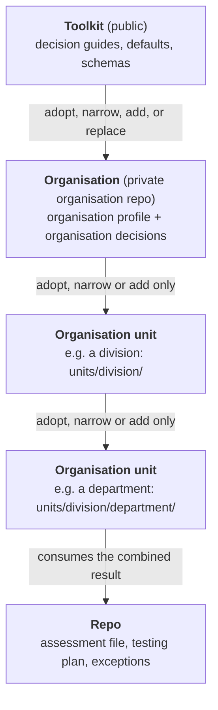

# Adopting the toolkit in your organisation

This guide is for an organisation that wants to use the toolkit on its own repositories. It assumes what is usually
true in a large company:

- **You can't install things from the internet.** Everything arrives through your own package repository (for example
  Artifactory or Nexus) and your own internal copies of source code.
- **Your platforms are fixed.** Your build tools, CI, deployment, issue tracker, code-hosting platform and AI
  assistant are already chosen. The toolkit fits around them; it never asks you to replace one.
- **Your details stay private.** Nothing about your organisation goes into the toolkit. It lives in your own private
  organisation repo.

Words follow [GLOSSARY.md](GLOSSARY.md). The decisions behind each step are linked as you go. For the corporate
environment these steps assume, in detail, see [docs/CORPORATE-USE.md](docs/CORPORATE-USE.md).

---

## Before you start: what is ready and what isn't

| Part | Ready to use | Still to come |
|---|---|---|
| Decision guides, glossary, technique rules | Yes | – |
| Lessons and their videos | In their own repo, [under-test-lessons](https://github.com/fiftiesHousewife/under-test-lessons): see its [catalogue](https://github.com/fiftiesHousewife/under-test-lessons/blob/main/lessons/CATALOGUE.md) | Planned there |
| Licence | Apache-2.0 for everything | – |
| Gradle conventions and quality checks, with the `underTest` settings | Yes, from this repo's source | Published as a versioned plugin you can mirror |
| Organisation profile schema and example organisation repo | Yes | A validator |
| Organisation-unit settings and the tool that combines the levels | Designed | Built |
| Backlog import | GitHub importer (Python standard library, GitHub REST API; works with internal GitHub servers) | Jira adapter; a version that needs nothing but Java |
| The toolkit as one APM package, pinned to a release tag ([why](docs/decisions/0051-the-toolkit-reaches-each-repo-through-apm-pinned-to-a-release-tag-and-nothing-in-it-is-copied.md)) | Decided | Its `apm.yml` installing the guides, schemas and technique rules with the skills |
| Repo classifier | Designed, output format published | Built |
| Maven and npm set-ups | Designed | Built |
| Repos with several applications ([why](docs/decisions/0053-a-repo-with-several-applications-keeps-each-applications-testing-files-in-their-own-folder-under-testing.md)) | Decided: a folder per application under `testing/` | Every skill taking the application's folder |

Until a part is published as an artifact, you would build it from your internal copy of this repo.

## Levels of adoption

Adoption happens at four levels. Each level builds on the one above, and may **enrich** it but never **contradict** it.



| Level | Where it lives | It may | It may not |
|---|---|---|---|
| **Toolkit** | This repo | Offer options and defaults | Contain anything organisation-specific |
| **Organisation** | Private organisation repo: `organisation-profile.yaml`, `docs/decisions/` | Adopt, narrow or replace a toolkit guide (giving reasons), add decisions, set facts | Be published |
| **Organisation unit** (any depth) | Same organisation repo, under `units/<path>/`, owned by that unit through code-owner rules | Adopt or narrow a decision from above (choose an option left open, tighten a threshold), add decisions on things not covered above | Replace or loosen anything decided above |
| **Repo** | The repo itself: `testing/assessment.yaml`, `testing/TESTING-PLAN.md` | Record what is specific to it; ask for a time-limited exception | Make decisions that loosen anything |

**How a repo's settings are worked out.** Starting from the toolkit's defaults, each level's settings are applied in
order: organisation, then each unit from the top down. Thresholds take the strictest value (if the organisation says
70% coverage and a department says 80%, the repo needs 80%). A choice must be one the level above allowed. A tool
checks that no level contradicts the one above, and lists which level set each value.

**When a repo can't comply.** The repo records an exception in its assessment file: which decision, why, and an
expiry date. It is approved by the role that owns that decision at the level that made it. Expired exceptions fail
the build.

*Background:* [Decisions cascade from toolkit to organisation to organisation units to repos, and lower levels only enrich](docs/decisions/0007-decisions-cascade-from-toolkit-to-organisation-to-organisation-units-to-repos-and-lower-levels-only-enrich.md)
and [A repo that cannot meet a decision gets a time-limited exception approved by the deciding role](docs/decisions/0008-a-repo-that-cannot-meet-a-decision-gets-a-time-limited-exception-approved-by-the-deciding-role.md).

---

## Step 1: Agree roles and sponsorship

Name the people for each engagement role in [the glossary](GLOSSARY.md#engagement-roles): Programme Sponsor,
Engagement Lead, Technical Architect, Test Quality Lead, Security and Platform Owner, Toolkit Owner, and the
Steering Group. Application Owners join as their applications come into scope.

*Background:* [The programme runs as a forward deployed engagement with named roles](decision-guides/0001-the-programme-runs-as-a-forward-deployed-engagement-with-named-roles.md).

## Step 2: Bring the toolkit inside your network

Nothing is fetched from the internet at build time. Before anyone uses the toolkit:

1. **Take the toolkit by version, with APM.** Keep an internal mirror of this repository. Each repo's `apm.yml` names
   the toolkit at a release tag from your mirror, and `apm install` puts its skills where your AI assistant finds them,
   with the decision guides, schemas and technique rules beside them. Nothing in it is copied or edited: you change
   what it says only through your own decision records (step 6). Your organisation profile names the same tag
   (`toolkit.version`); your Toolkit Owner decides when to take a newer one, a one-line change by pull request.
2. **Mirror the dependencies.** Your package repository needs proxies (remote repositories) for Maven Central and the
   Gradle Plugin Portal, which most organisations already have. The full list of what the toolkit uses is in
   [`gradle/libs.versions.toml`](gradle/libs.versions.toml). Your security review approves those, as with any
   library. The toolkit keeps that list short on purpose: it prefers tools you probably already have, and runs PMD's
   copy-paste detector directly instead of adding another plugin. The find-test-anti-patterns skill needs PMD itself
   (`net.sourceforge.pmd:pmd-cli` and `pmd-java`), which the toolkit's
   [pmd-install](tools/test-anti-patterns/pmd-install/build.gradle) fetches from your package repository
   ([why](docs/decisions/0067-find-test-anti-patterns-needs-pmd-and-installs-it-when-it-is-missing.md)). The
   draft-the-connection-list skill needs [connection-paths](https://github.com/fiftiesHousewife/connection-paths), one
   jar published beside each of its version tags: mirror it, and name its path in your organisation profile
   (`tools.connection_paths_jar`). It reads each module with the classpath its build resolves, so the build must reach
   your package repository; building without running tests is allowed in discovery
   ([why](docs/decisions/0073-a-repo-may-be-built-without-running-its-tests-before-the-safety-gate.md)).
3. **Provide the Gradle distribution and the JDK.** Point the Gradle wrapper at your internal copy of the Gradle
   distribution (`distributionUrl` in `gradle/wrapper/gradle-wrapper.properties`). Install JDK 25 on build machines
   and developer machines through your usual software channel. Then switch off Gradle's automatic JDK download, as in
   step 4.

## Step 3: Create your private organisation repo

Copy [`examples/organisation-repo/`](examples/organisation-repo/README.md) into a new **private** repo. Fill in
`organisation-profile.yaml` with your facts:

| Field | What you record | Example |
|---|---|---|
| `issue_tracker` | Where work is tracked | Jira Cloud, project TEST |
| `code_hosting`, `ci` | Your code-hosting and CI platforms; what builds run on; your image build tool | Kubernetes-based CI with Buildah |
| `developer_machines` | Whether developers can run containers | No container runtime |
| `package_repository` | Your package repository | Artifactory |
| `ai_assistants` | The AI assistants you allow; whether unattended AI agents are allowed | One approved assistant; agents not allowed |
| `commit_messages` | Whether every commit must name a work item, and the key pattern | Required, `[A-Z][A-Z0-9]+-[0-9]+` |
| `feature_flags` | Your flag product, if any | |
| `roles` | Who fills each role | |

The file is checked against [the organisation profile schema](schema/organisation-profile.schema.json). Facts with no
choice go here; choices go in your own decision records (step 6).

*Background:* [Organisation-specific facts and decisions live in a private organisation repo](docs/decisions/0003-organisation-specific-facts-and-decisions-live-in-a-private-organisation-repo.md).

## Step 4: Keep your build environment

Your proxy, package repository, credentials and JDK locations stay where they already are: a Gradle init script (or
`gradle.properties` in the Gradle user home) and Maven's `settings.xml`. These apply before any repo's own settings,
so the toolkit never needs to know them. Keep a copy, or a pointer to it, in your organisation repo. A typical Gradle init
script does four things:

```kotlin
// ~/.gradle/init.d/organisation.init.gradle.kts (placeholder values)
settingsEvaluated {
    pluginManagement.repositories { clear(); maven("https://packages.example.com/gradle-plugins") }
    dependencyResolutionManagement.repositories { clear(); maven("https://packages.example.com/maven") }
}
```

```properties
# ~/.gradle/gradle.properties (placeholder values)
systemProp.https.proxyHost=proxy.example.com
systemProp.https.proxyPort=8080
org.gradle.java.installations.auto-download=false
org.gradle.java.installations.paths=/opt/jdk-25
underTest.codeStyle=TOOLKIT
```

*Background:* [The build environment (proxy and package repository) comes from the organisation's own build set-up](docs/decisions/0012-the-build-environment-proxy-and-package-repository-comes-from-the-organisations-own-build-set-up.md).

## Step 5: Fit your code-quality standards

Build checks come in three layers:

| Layer | Who owns it | What you can do |
|---|---|---|
| Environment (proxy, package repository) | You | Always yours (step 4) |
| Code-quality standards (style, complexity, copy-paste, bug and security-bug analysis, forbidden APIs) | You choose | `underTest.codeStyle=TOOLKIT` (ours), `ORGANISATION` (our tools with your rule files), or `NONE` (your own plugin or quality gate) |
| Testing evidence (coverage, flaky-test detection, mutation sampling, checks on AI-written tests) | The programme | Always on. You set thresholds such as `underTest.minLineCoverage` through your own decisions |

```properties
underTest.codeStyle=ORGANISATION
underTest.checkstyleConfig=/path/to/your/checkstyle.xml
underTest.pmdRuleset=/path/to/your/pmd-ruleset.xml
underTest.forbiddenApiSignatures=/path/to/your/forbidden-signatures.txt
underTest.minLineCoverage=0.70
```

Testing evidence is defined by standard report files (JaCoCo, PIT, JUnit XML), not by one build plugin, so Maven and
npm repos can take part once their set-ups exist.

*Background:* [Build settings come in three layers](docs/decisions/0011-build-settings-come-in-three-layers-environment-code-quality-standards-and-testing-evidence.md)
and [Code-quality standards can be the toolkit's, the organisation's, or the organisation's own plugin](docs/decisions/0013-code-quality-standards-can-be-the-toolkits-the-organisations-or-the-organisations-own-plugin.md).

## Step 6: Work through the decision guides

The [decision guides](decision-guides/README.md) cover every choice the programme needs, smallest first. You don't
write a record for each one
([why](docs/decisions/0052-an-organisation-adopts-every-decision-guide-in-its-toolkit-version-by-default-and-records-only-its-departures.md)):

- **Your first record adopts them all**: every decision guide in your toolkit version, as written, except the ones
  your other records depart from.
- **Record only departures**, as they come up: choosing between a guide's options, narrowing it, or replacing it, each
  naming the guide and giving the reason.
- **On a newer toolkit version**, update the first record and review only the guides the release says changed.

Use the [record-an-organisation-decision skill](.github/skills/record-an-organisation-decision/SKILL.md) with your AI
assistant to draft these. It writes into your organisation repo only. Settle the production-safety decisions and the container
decision first, because most others depend on them.

## Step 6a: Let organisation units add their own decisions

Each organisation unit that wants its own decisions or stricter settings gets a folder in the organisation repo, under
`units/<path>/`, owned by that unit's leads through code-owner rules. A unit's decision records name the decision
above that they narrow, or say that they add something new. A unit can't replace or loosen anything decided above it;
the combining tool rejects that.

## Step 7: Make production safe before running anything

Old repos often hold production secrets and can reach production systems once running. Before anyone builds or runs
one, by hand, with an AI assistant, or in CI:

1. **Scan for secrets** with the tool you already use, or your code-hosting platform's own scanning.
2. **Run old code first only on CI runners that can't reach production.** Separate them by network, not by
   configuration.
3. **Switch on the production-address check** in the convention plugin once it exists.

*Background:* the decisions in [Keeping production safe](docs/decisions/README.md#keeping-production-safe).

## Step 8: Connect your issue tracker and commit rules

1. **Import the starting backlog** into your tracker with the importer for it (see
   [tools/backlog-import](tools/backlog-import/README.md)). The Jira adapter is still to be built. In an environment
   without Python, wait for the Java version, or load the seed with your tracker's own bulk import.
2. **If every commit must name a work item**, set `commit_messages` in your profile. AI assistant skills then include
   the key in every commit, and the commit-message checks switch on.

*Background:* [The programme backlog lives in the organisation's issue tracker, not in a file](docs/decisions/0009-the-programme-backlog-lives-in-the-organisations-issue-tracker-not-in-a-file.md)
and [When the organisation requires it, every commit names its work item](decision-guides/0028-when-the-organisation-requires-it-every-commit-names-its-work-item.md).

## Step 9: Give your AI assistant the skills

Skills arrive the same way as libraries. The skills bundle is a versioned artifact, mirrored through your package
repository, and unpacked by `./gradlew installSkills` into the folders your approved AI assistant reads. No new
installer is needed. APM (Agent Package Manager) is an optional extra, for organisations that allow it. People direct
the AI and review everything it produces; unattended AI agents stay off unless your profile allows them.

*Background:* [How AI assistant skills and instructions reach every repo](docs/decisions/0019-how-ai-assistant-skills-and-instructions-reach-every-repo.md).

## Step 10: Run the programme

The [repo journey diagrams](docs/design/repo-journey.md) show each step below, the two tracks, connection lists and who does what.


1. **Classify your repos.** Run the repo classifier on each repo, or build a survey tool that calls it across your
   code-hosting platform ([design](docs/design/survey-tool.md)).
2. **Pilot.** Treat one application by hand for each common combination of technology stack and application type.
   Turn what you learn into testing guides.
3. **Roll out in batches.** For each repo: measure, generate a testing plan, have the Application Owner approve it,
   load its work into your tracker, and work through the workstreams.
4. **Hand over.** Your own teams run the batches, and the Toolkit Owner role moves inside your organisation.

## Keeping up to date

- Take new toolkit releases deliberately. Update the pinned version in your organisation repo through a pull request, and read
  the decision guides that changed. Accepted decision records are never edited; a change arrives as a new record.
- Re-run your profile validation and builds after each upgrade.
- Send improvements that would help any organisation back to the toolkit. Never send organisation details.
