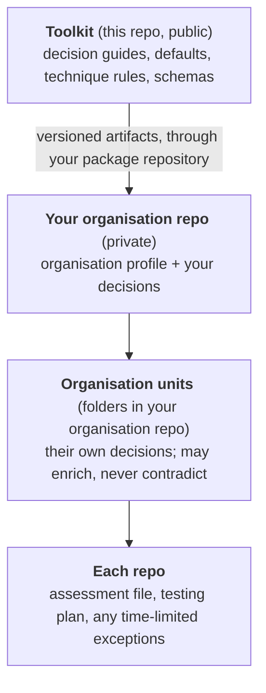

# under-test

[](https://github.com/fiftiesHousewife/under-test/actions/workflows/build.yml)
[](LICENSE)


[](decision-guides/README.md)

**A toolkit for getting old code properly tested, one repo at a time.**

Many organisations have hundreds or thousands of repositories with few or weak tests. This toolkit helps a team,
working with AI coding assistance, find out what each repo needs, plan the work, and do it safely. It gives you:

- **Decision guides:** one short record per choice the programme has to make, with the options and what follows.
- **Build conventions and tools** that measure test quality and apply good practice in every build.
- **Technique rules:** for each testing technique, when to adopt, defer or reject it for a repo, and what to use
  instead.
- **AI assistant skills** that let an AI help with the work while a person reviews everything it produces.
- Planned: **a repo classifier** that says what kind of codebase a repo is, for people or for a survey tool to call.

**Lessons** that teach each technique, with a runnable before-and-after example, slides and a narrated video, are in
their own repo, [under-test-lessons](https://github.com/fiftiesHousewife/under-test-lessons).

The toolkit is **generic**: nothing in it is specific to one organisation, and it's designed to work inside locked-down
corporate networks.

## Where to start

| You are… | Read |
|---|---|
| Evaluating it for a company with a locked-down network (no internet installs, no public code hosting, your own package repository, proxy, tracker and wiki) | [docs/CORPORATE-USE.md](docs/CORPORATE-USE.md): the assumptions it is built for, and how each part reaches people |
| Ready to adopt it in your organisation | [ADOPTION.md](ADOPTION.md): step by step, from naming roles to rolling out in batches |
| Learning a testing technique | [under-test-lessons](https://github.com/fiftiesHousewife/under-test-lessons): lessons, runnable examples and narrated videos |
| Making or reviewing a programme decision | [decision-guides/](decision-guides/README.md): decision guides, smallest first |
| An AI coding assistant, or directing one | [AGENTS.md](AGENTS.md): how to work in this repo, and the code standards |
| Unsure of a word | [GLOSSARY.md](GLOSSARY.md) |
| Following the toolkit's own progress | [docs/BACKLOG.md](docs/BACKLOG.md): open work, ordered and linked to its issues |

## Adopting it, in brief

You never change or fork this repo to use it. Your organisation keeps its own facts and choices in a separate, private
**organisation repo**, and receives the toolkit by version number through its own package repository.



- **Your environment stays yours.** Proxy, package repository, JDK and credentials remain in your existing Gradle or
  Maven set-up.
- **Your standards stay yours.** Use the toolkit's code-quality rules, your own rule files, or your own plugin
  (`underTest.codeStyle`). The testing evidence the programme relies on always runs.
- **Your platforms stay yours.** Issue tracker, CI, code hosting and AI assistant are named in your organisation
  profile; the toolkit adapts to them.

Full detail: [ADOPTION.md](ADOPTION.md) and [docs/CORPORATE-USE.md](docs/CORPORATE-USE.md).

## Try it

You need JDK 25. The Gradle wrapper fetches everything else.

```bash
git clone https://github.com/fiftiesHousewife/under-test.git
cd under-test
./gradlew check
```

`check` runs the tests and every quality check: coverage, style, complexity, copy-paste detection, bug and
security-bug analysis (SpotBugs with FindSecBugs), and forbidden APIs. See
[the code standards](AGENTS.md#code-standards-enforced-by-gradlew-check).

### See mutation testing catch weak tests

The [mutation testing lesson](https://github.com/fiftiesHousewife/under-test-lessons/blob/main/lessons/mutation-testing/README.md), in the lessons repo, has two test suites with the same 100% line
coverage. One catches bugs; the other doesn't:

```bash
git clone https://github.com/fiftiesHousewife/under-test-lessons.git
cd under-test-lessons
./gradlew :lessons:mutation-testing:pitest -Psuite=weak   # 5 of 13 deliberately introduced bugs caught
./gradlew :lessons:mutation-testing:pitest                # 13 of 13 caught
```

The difference comes down to tests like these:

```java
// Weak: passes for any positive discount, so a wrong percentage goes unnoticed
assertTrue(calc.discountPercent(200, false) > 0);

// Strong: checks both sides of each boundary, and reports every failure at once
assertAll(
        () -> assertThat(calc.discountPercent(49, false)).isZero(),
        () -> assertThat(calc.discountPercent(50, false)).isEqualTo(5),
        () -> assertThat(calc.discountPercent(100, false)).isEqualTo(10));
```

## Lessons and videos

Lessons, their slides and narrated videos, and the tools that make them are in
[under-test-lessons](https://github.com/fiftiesHousewife/under-test-lessons): its
[catalogue](https://github.com/fiftiesHousewife/under-test-lessons/blob/main/lessons/CATALOGUE.md) lists every
technique here and the lessons that teach it, and its guide to
[using the lessons inside a company](https://github.com/fiftiesHousewife/under-test-lessons/blob/main/docs/using-inside-a-company.md)
explains how to rebrand, trim or revoice the videos. Each lesson names the techniques it teaches, and that repo's build
checks they match the techniques here.

## Surveying many repos

Surveying every repo in an organisation is outside this toolkit. Its repo classifier works on one repo and writes a
result in [a published format](schema/repo-classification.schema.json), so any survey tool can call it.
[A design for such a tool](docs/design/survey-tool.md) shows how to survey a GitHub organisation.

## What's in this repo

| Folder | What you'll find |
|---|---|
| [`ADOPTION.md`](ADOPTION.md), [`docs/CORPORATE-USE.md`](docs/CORPORATE-USE.md) | How to adopt the toolkit, and the corporate environment it is built for |
| [`techniques/`](techniques/README.md) | The rules for when to use each testing technique, read by the toolkit's tools |
| [`decision-guides/`](decision-guides/README.md) | Decision guides for adopting organisations, one small decision each, building from foundations upward |
| [`docs/decisions/`](docs/decisions/README.md) | The toolkit's own decisions: how it is built, published and adopted |
| [`docs/design/`](docs/design/repo-journey.md) | Diagrams of a repo's journey, and designs for tools outside the toolkit |
| [`self/`](self/README.md) | The toolkit adopting itself: its own organisation profile |
| [`docs/REFERENCES.md`](docs/REFERENCES.md), [`docs/research/`](docs/research/calm-and-allium-for-test-design.md) | Background reading, sources, and research reports |
| [`GLOSSARY.md`](GLOSSARY.md) | The words we use, the words we avoid, the engagement roles and phases |
| [`examples/organisation-repo/`](examples/organisation-repo/README.md) | The shape of an organisation repo, with placeholder values |
| [`schema/`](schema/) | JSON Schemas for every YAML and JSON format the toolkit reads or writes |
| [`tools/`](tools/) | Tools: [repo checks](tools/repo-checks/build.gradle.kts), [backlog importers](tools/backlog-import/README.md), [maintainer sync](tools/sync/README.md) |
| [`templates/programme-backlog.yaml`](templates/programme-backlog.yaml) | An organisation's starting backlog, to import into its own issue tracker |
| [`plan/toolkit-backlog.yaml`](plan/toolkit-backlog.yaml) | Work to build the toolkit itself (this repo's issues) |
| [`build-logic/`](build-logic/), [`config/quality/`](config/quality/) | Gradle conventions and quality-check rules |
| [`AGENTS.md`](AGENTS.md) | How AI coding assistants, and people, should work here |

## Licence

Apache License 2.0, for everything in this repository: code, tools and guides. The lessons and videos, in their own repo, use the same licence. See [LICENSE](LICENSE)
and [NOTICE](NOTICE).

## Contributing

Read [AGENTS.md](AGENTS.md) and [GLOSSARY.md](GLOSSARY.md) first. In short: plain English, refer to things by name with
a link, a schema for every YAML file, nothing organisation-specific, and `./gradlew check` must pass.
