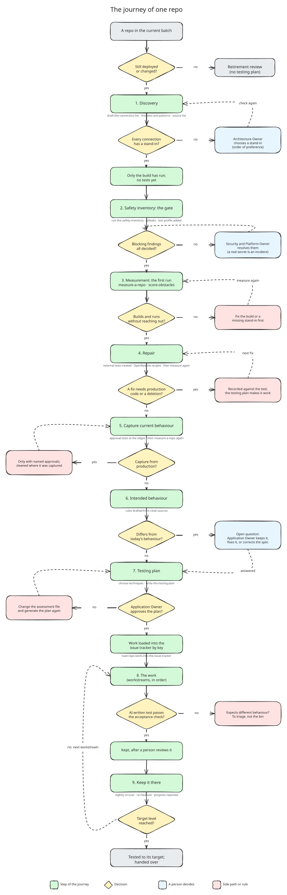

# under-test

**A method, with the rules, schemas and AI assistant skills that go with it, for getting an organisation's old code
properly tested, one repo at a time.**

It is for the team that goes in to do it: Forward Deployed Engineers with AI coding assistance, working alongside the
organisation's own Application Owners and experts, and then handing over. It holds nothing specific to any one
organisation, works inside locked-down corporate networks, and never lets an AI work unattended.

## The journey of one repo

The drawing's source is [repo-journey.excalidraw](docs/design/repo-journey.excalidraw); open it in Excalidraw to
change it, then export it again with [drawing-export](maintainer-tools/drawing-export/README.md).

Across an organisation, the journey repeats in batches, through five phases: set-up, finding out what repos there
are, pilots, rolling out, and handing over.

Every choice behind these steps is a [decision guide](decision-guides/README.md) that each organisation accepts,
narrows or replaces. [The full journey](docs/JOURNEY.md) says who does each step and links every guide, and
[the prior art](docs/PRIOR-ART.md) sets each step against the published research and practice it draws on, and what
changes when AI assistants do the work.

## Skills

Each step is done by an AI assistant skill that runs tools and writes to the repo's files; a person reviews what it
writes. Whatever a program can decide the same way every time is done by a tool, and the skill keeps the judgement
([why](docs/decisions/0075-a-skills-mechanical-steps-are-done-by-deterministic-tools-and-the-skill-keeps-only-judgement.md)). Every skill is tried against the same task done without it, and kept only if it saves effort or makes
the result the same every time.

| Step | Skill | What it does | Tried with and without it |
|---|---|---|---|
| 1 | [draft-the-connection-list](.github/skills/draft-the-connection-list/SKILL.md) | Runs [connection-paths](https://github.com/fiftiesHousewife/connection-paths) to find every connection the code opens and every test that may reach one, traces each address, and drafts the connection list with a stand-in for each; later merges in the airgap agent's reports | [From the airgap agent's reports: a third fewer tool calls; production marked and stand-ins proposed, which the run without it missed](docs/skill-evaluations/draft-the-connection-list.md). The pass from the code was tried by hand on Openfire; its eval case is in the backlog |
| 1 | [find-test-anti-patterns](.github/skills/find-test-anti-patterns/SKILL.md) | Runs PMD with the toolkit's rules over the existing tests, records every test it finds in the list of tests, and counts the anti-patterns | [The same counts in four runs of five, and more problems found](docs/skill-evaluations/find-test-anti-patterns.md) |
| 2 | [run-the-safety-inventory](.github/skills/run-the-safety-inventory/SKILL.md) | Turns gitleaks' reports, and a list of keystores ever committed, into the assessment file's safety section: the gate before the first run | [About 40% fewer tool calls and tokens; ids the same every run; no secrets in the reply](docs/skill-evaluations/run-the-safety-inventory.md) |
| 3 | [measure-a-repo](.github/skills/measure-a-repo/SKILL.md) | Runs the tests five times under the airgap agent, with coverage and planted bugs, through an init script that changes nothing in the build | [A third fewer tool calls and half the time; the same result shape on Gradle 6.9 and 9](docs/skill-evaluations/measure-a-repo.md) |
| 3 | [score-obstacles](.github/skills/score-obstacles/SKILL.md) | Scores each obstacle to testing 0 to 3 by the named list, with the evidence for each | Not yet tried: its eval case runs with the baseline |
| 6 | [choose-techniques](.github/skills/choose-techniques/SKILL.md) | Proposes adopt, defer or reject for every technique, each traced to its rule | [Two runs agree on 22 of 23 techniques](docs/skill-evaluations/choose-techniques.md) |
| 6 | [write-the-testing-plan](.github/skills/write-the-testing-plan/SKILL.md) | Generates the testing plan from the assessment file, every piece of work with a stable key for the tracker | [Two runs give the same 15 pieces of work, keys and order](docs/skill-evaluations/write-the-testing-plan.md) |
| 6 | [load-repo-work-into-the-issue-tracker](.github/skills/load-repo-work-into-the-issue-tracker/SKILL.md) | Turns an approved testing plan into work items | Not yet: waits for the loader |
| All | [render-the-assessment-report](.github/skills/render-the-assessment-report/SKILL.md) | Fills the report page from the repo's files, and applies people's changes back | [Half the tool calls and tokens, a sixth of the time; the same page for every repo](docs/skill-evaluations/render-the-assessment-report.md) |

The tools the skills run:

| Tool | What it does |
|---|---|
| [connection-paths](https://github.com/fiftiesHousewife/connection-paths) | Reads a Java module's source and finds where it opens connections and which tests can reach them, with the chain of calls; its own repo, one jar |
| [under-test-tools](https://github.com/fiftiesHousewife/under-test-tools) | The mechanical steps of the journey's skills, one sub-command each; its first, `anti-patterns`, does find-test-anti-patterns' listing, PMD run, counting and writing. Built, not yet published |
| [The toolkit's PMD rules](tools/test-anti-patterns/anti-patterns.pmd.xml) | Find the anti-patterns in tests that PMD can see: tests that never run, have no real assertion, swallow failures, sleep, run in a fixed order, or mock everything |
| [gitleaks](https://github.com/gitleaks/gitleaks), with [the toolkit's rules](tools/safety-inventory/) | Finds secrets and production credentials, over the whole history |
| [The airgap agent](https://github.com/fiftiesHousewife/under-test-airgap) | Refuses every call off the machine when old code first runs on a developer's machine, and reports it |

Each journey skill is also evaluated repeatably with `claude plugin eval`: [the latest results](docs/skill-evaluations/eval-results.md), and
[each skill with and without it, round by round](docs/skill-evaluations/skill-versions-compared.md), and
[what the skills produce](docs/skill-evaluations/what-the-skills-produce.md) for an example repo.

## Where to start

| You are… | Read |
|---|---|
| Evaluating it for a locked-down corporate network | [docs/CORPORATE-USE.md](docs/CORPORATE-USE.md) |
| Ready to adopt it | [ADOPTION.md](ADOPTION.md) |
| Following a repo through the journey | [docs/JOURNEY.md](docs/JOURNEY.md) |
| Learning a testing technique | [under-test-lessons](https://github.com/fiftiesHousewife/under-test-lessons) |
| An AI coding assistant, or directing one | [AGENTS.md](AGENTS.md), which also maps this repo |
| Unsure of a word | [GLOSSARY.md](GLOSSARY.md) |

## What's here

| | Where |
|---|---|
| Decision guides, one small choice each | [`decision-guides/`](decision-guides/README.md) |
| Rules for when each testing technique fits | [`techniques/`](techniques/README.md) |
| Schemas for every file a repo gets | [`schema/`](schema/) |
| AI assistant skills for each step | [`.github/skills/`](.github/skills/) |
| Templates and rule files | [`templates/`](templates/), [`tools/`](tools/) |
| The toolkit's own decisions and backlog | [`docs/decisions/`](docs/decisions/README.md), [docs/BACKLOG.md](docs/BACKLOG.md) |

Most guides are still proposed defaults, and the journey's skills are being added and tried one step at a time.

## Licence and contributing

Apache License 2.0 (see [LICENSE](LICENSE) and [NOTICE](NOTICE)). Before contributing, read [AGENTS.md](AGENTS.md):
plain English, nothing organisation-specific, and `./gradlew check` must pass.
