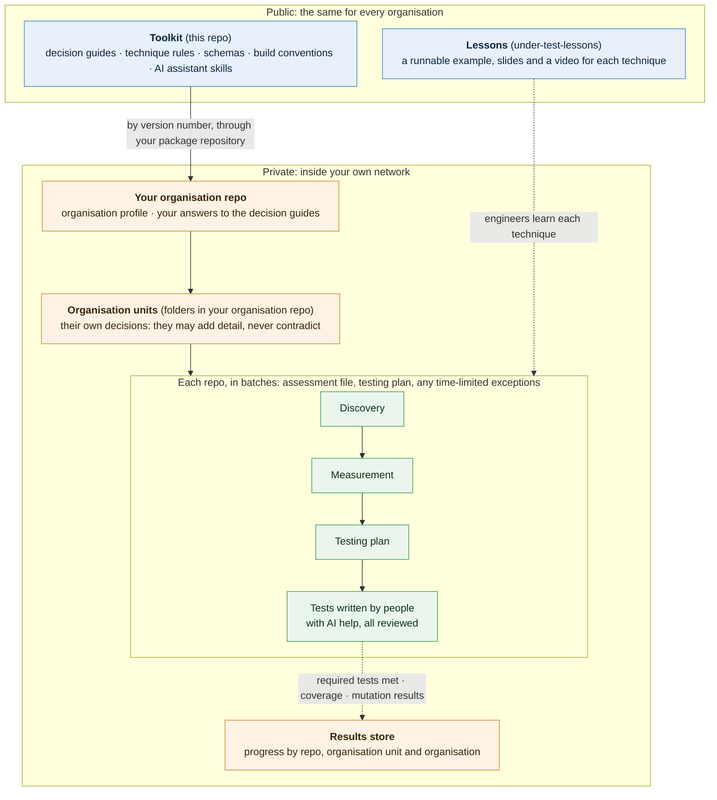

# under-test

**A method, and the files, rules and tools that go with it, for getting an organisation's old code properly tested,
one repo at a time.**

Many organisations have hundreds or thousands of repositories with few or weak tests, written by people who have
moved on, talking to systems nobody fully remembers. under-test is for the team that goes in to fix that: Forward
Deployed Engineers with AI coding assistance, an Engagement Lead, a Technical Architect and a Test Quality Lead,
working alongside the organisation's own Application Owners, experts and security people, and then handing the work
over to them.

## What the toolkit is

Four things, used together:

| | What it is | Where |
|---|---|---|
| **A method** | The journey every repo takes, from "nobody dares run it" to "tested to its target", and how an organisation moves through all its repos. Written as decision guides: one short record per choice, with the options, a recommended default, and what follows. | [`decision-guides/`](decision-guides/README.md) |
| **The files each repo gets** | A connection list (what the code talks to), an assessment file (what was measured and what people decided), a testing plan (generated from the assessment file, approved by the Application Owner), and a source list (the knowledge that counts). Each format has a schema, or will have. | [`schema/`](schema/), [`templates/`](templates/) |
| **Rules and tools** | For each testing technique, the rules for when a repo should adopt, defer or reject it. Tools that do the mechanical steps, most still to be built: scan for secrets, measure a repo, mark techniques, generate the plan, load the work into the issue tracker. | [`techniques/`](techniques/README.md), [`tools/`](tools/) |
| **AI assistant skills** | Instructions that let an AI assistant do the drafting (rules, questions, tests) while a person reviews everything it produces. | [`.github/skills/`](.github/skills/) |

It is **not** a test framework, a hosted service or a template you fork and edit. It holds nothing specific to any
one organisation: each organisation keeps its own facts and answers in a private organisation repo and receives the
toolkit by version number. It is built to work inside locked-down corporate networks, and it never lets an AI work
unattended.

## The journey of one repo

```mermaid
%%{init: {"flowchart": {"wrappingWidth": 230, "nodeSpacing": 28, "rankSpacing": 36}}}%%
flowchart LR
    S["<b>1. Safety inventory</b><br/>secrets, real data, jobs that start themselves, first run unplugged"] --> D["<b>2. Discovery</b><br/>connection list · source list · existing tests and their anti-patterns"]
    D --> C["<b>3. Capture current behaviour</b><br/>capture, clean in place, check, approval tests"]
    C --> M["<b>4. Measurement</b><br/>builds, runs alone, flaky tests, coverage, mutation"]
    M --> B["<b>5. Intended behaviour</b><br/>specification from sources and experts"]
    B --> P["<b>6. Testing plan</b><br/>techniques, target level, approved"]
    P --> W["<b>7. The work</b><br/>workstreams, in order, reviewed"]
    W --> K["<b>8. Keep it there</b><br/>re-measured, progress reported"]
    classDef step fill:#eaf6ec,stroke:#3c9a52,color:#0f2e17
    class S,D,C,M,B,P,W,K step
```

Each step says who does it, what it leaves in the repo, and which decision guides settle how. The guides hold the
detail; this page only summarises them, and links to each so the two stay in step.

### 1. Safety inventory

Before any of the repo's code runs, find what could reach production or real data. Its whole history is scanned for
secrets with gitleaks in CI; on laptops, FindSecBugs gives an early warning. The repo is also searched for keystores
and private keys, production credentials in its settings, real personal data in fixtures and dumps, jobs that start
by themselves, database migrations that run at start-up, build tasks that publish or deploy, fixed file paths and
Windows file shares, and native libraries. Secrets,
keys, production credentials and real personal data block every run until they're resolved, and a real production
secret is handled as a security incident. The rest are made harmless in the test profile or the build, and recorded.
The first run of the code happens only where production can't be reached: in CI on runners with no route out, and on
an engineer's own machine only under the [airgap agent](https://github.com/fiftiesHousewife/under-test-airgap), which
refuses every call off the machine and reports it. From then on the repo runs with a test profile and dummy secrets by
default, and tests stop at once if any configured address belongs to production.

- **Who:** a Forward Deployed Engineer, with the tools; the Security and Platform Owner approves anything accepted
  rather than fixed.
- **Leaves in the repo:** the inventory's findings in the assessment file; a test profile; a `.gitleaksignore` with
  reasons.
- **Decided in:** [Before any code runs, a safety inventory records what could reach production or real data, and some findings block the run](decision-guides/0057-before-any-code-runs-a-safety-inventory-records-what-could-reach-production-or-real-data-and-some-findings-block-the-run.md), [No repo's code is built or run until its secrets scan is clean](decision-guides/0007-no-repos-code-is-built-or-run-until-its-secrets-scan-is-clean.md), [A production secret found in a repo is handled as a security incident](decision-guides/0011-a-production-secret-found-in-a-repo-is-handled-as-a-security-incident.md), [Old code runs first only where production cannot be reached](decision-guides/0008-old-code-runs-first-only-where-production-cannot-be-reached.md), [A test profile with dummy secrets is the default, and production profiles only work in production](decision-guides/0010-a-test-profile-with-dummy-secrets-is-the-default-and-production-profiles-only-work-in-production.md), [Tests stop at once if any configured address is a production address](decision-guides/0009-tests-stop-at-once-if-any-configured-address-is-a-production-address.md).

### 2. Discovery

Find out what the code talks to and what tests it already has, before changing anything. The airgap agent's report
from the first runs is the draft connection list: every interface, database, queue and outside service the code tried
to reach, with what tests will use instead of each and which addresses tests must never reach; the Architecture Owner
confirms it. The Knowledge Curator lists the sources that count: regression packs, wiki pages, tracker queries, other
repos, and the test assets that live outside the repo, such as automation suites run against a shared test
environment and manual test scripts. Those keep running where they are until repo tests cover the same journeys, and
never count as evidence. The repo's own tests are checked for anti-patterns: no real assertions, disabled tests,
sleeps, order dependence, reaching shared systems, mocking everything. Each is recorded and triaged, and no existing
test is deleted before current behaviour is recorded.

- **Who:** a Forward Deployed Engineer; the Architecture Owner, the Knowledge Curator and the Application Owner (for
  disabled tests).
- **Leaves in the repo:** `testing/connections.calm.json`, the application's source list, the anti-pattern findings
  in the assessment file.
- **Decided in:** [Every repo starts with discovery: a draft connection list, an approval-test baseline and a source list](decision-guides/0032-every-repo-starts-with-discovery-a-draft-connection-list-an-approval-test-baseline-and-a-source-list.md), [Each application's connections are recorded as a CALM connection list](decision-guides/0030-each-applications-connections-are-recorded-as-a-calm-connection-list.md), [The connection list says what tests use for each connection, and which addresses tests must never reach](decision-guides/0031-the-connection-list-says-what-tests-use-for-each-connection-and-which-addresses-tests-must-never-reach.md), [Knowledge sources are listed by the knowledge curator and read through Allium skills with a citation addendum](decision-guides/0034-knowledge-sources-are-listed-by-the-knowledge-curator-and-read-through-allium-skills-with-a-citation-addendum.md), [Each application also has a knowledge curator and an architecture owner](decision-guides/0002-each-application-also-has-a-knowledge-curator-and-an-architecture-owner.md), [Test assets outside the repo are mined for behaviour, and kept running until repo tests replace them](decision-guides/0058-test-assets-outside-the-repo-are-mined-for-behaviour-and-kept-running-until-repo-tests-replace-them.md), [Anti-patterns in existing tests are recorded and triaged, and no existing test is deleted before the approval-test baseline exists](decision-guides/0059-anti-patterns-in-existing-tests-are-recorded-and-triaged-and-no-existing-test-is-deleted-before-the-approval-test-baseline-exists.md).

### 3. Capture current behaviour

Record what the code does today at its edges, so any later change in behaviour shows up. Behaviour is captured in
order of preference: generated examples first, then recordings of the code's outgoing calls in a test environment,
then a recording inside the application in a test environment, then copies from queues and batch files, then subsets
of a test database; from production only with named approvals. Everything captured is cleaned inside the environment
it was captured in, before it's copied anywhere: secrets and free text dropped, identifiers replaced by keyed
substitutes, other personal data by invented values. A detector check runs on every cleaned capture, a person signs
off the first sample, and cleaned captures are still treated as personal data unless the Data Protection Officer
agrees otherwise. The cleaned captures become approval tests and recorded responses.

- **Who:** a Forward Deployed Engineer; the Security and Platform Owner and the data owner for where capture happens;
  the Data Protection Officer for the legal status.
- **Leaves in the repo:** the first approval tests and recorded responses, cleaned; the cleaning rules live in the
  shared test kit for each system.
- **Decided in:** [Black-box captures are taken in non-production first, and from production only with named approvals](decision-guides/0060-black-box-captures-are-taken-in-non-production-first-and-from-production-only-with-named-approvals.md), [Order of preference for where current behaviour is captured](decision-guides/0061-order-of-preference-for-where-current-behaviour-is-captured.md), [Captured data is cleaned inside the environment it was captured in, before it is copied anywhere](decision-guides/0062-captured-data-is-cleaned-inside-the-environment-it-was-captured-in-before-it-is-copied-anywhere.md), [How personal data in captures is replaced: dropped, keyed substitutes or synthetic values, chosen per field](decision-guides/0063-how-personal-data-in-captures-is-replaced-dropped-keyed-substitutes-or-synthetic-values-chosen-per-field.md), [Cleaned captures pass a detector check before they are kept, and a person signs off the first sample](decision-guides/0064-cleaned-captures-pass-a-detector-check-before-they-are-kept-and-a-person-signs-off-the-first-sample.md), [Cleaned captures are treated as personal data unless the Data Protection Officer agrees they are anonymous](decision-guides/0065-cleaned-captures-are-treated-as-personal-data-unless-the-data-protection-officer-agrees-they-are-anonymous.md).

### 4. Measurement

A measurement run builds the repo, checks it starts on its own with outbound calls blocked, runs its tests five times
to find flaky ones, and measures coverage, the mix of test types and, on a sample, how many deliberately planted bugs
the tests catch (mutation testing). Each obstacle to testing it finds is scored, with evidence.

- **Who:** the measurement run, started by a Forward Deployed Engineer.
- **Leaves in the repo:** the `measured:` fields of `testing/assessment.yaml`; results also go to a central store.
- **Decided in:** [The assessment file: where it lives, who writes which fields, and its schema version](decision-guides/0023-the-assessment-file-where-it-lives-who-writes-which-fields-and-its-schema-version.md), [Where measured results are stored and how each repo sees its own](decision-guides/0025-where-measured-results-are-stored-and-how-each-repo-sees-its-own.md), [The named list of obstacles to testing and how each is scored](decision-guides/0029-the-named-list-of-obstacles-to-testing-and-how-each-is-scored.md).

### 5. Intended behaviour

What the code does today isn't always what it should do. The AI drafts rules from the listed sources, citing a
source for every rule, and compares them with the approval tests. Experts answer the differences in short, booked
question sessions. Every remaining difference is an open question that the Application Owner settles: keep today's
behaviour as a known issue, fix it deliberately, or correct the specification.

- **Who:** a Forward Deployed Engineer and the AI; subject-matter experts; the Application Owner.
- **Leaves in the repo:** a specification of intended behaviour, and its open questions.
- **Decided in:** [Behaviour is captured in two tracks, current and intended, and every difference is an open question](decision-guides/0033-behaviour-is-captured-in-two-tracks-current-and-intended-and-every-difference-is-an-open-question.md), [Expert time is booked as a budget of short question sessions](decision-guides/0035-expert-time-is-booked-as-a-budget-of-short-question-sessions.md).

### 6. Testing plan

The repo's target test maturity level follows from its business criticality. Each technique is marked adopt, defer or
reject for the repo from its rules and the measurements. The testing plan is generated from the assessment file,
never edited by hand, and approved by the Application Owner in one pull request. Its work then goes into the
organisation's issue tracker, one item per piece of work, and the tracker follows the work from there.

- **Who:** the Test Quality Lead and a Forward Deployed Engineer; the Application Owner approves.
- **Leaves in the repo:** decisions in `testing/assessment.yaml`, and `testing/TESTING-PLAN.md`.
- **Decided in:** [What each test maturity level means](decision-guides/0012-what-each-test-maturity-level-means.md), [Target test maturity level for each business criticality](decision-guides/0015-target-test-maturity-level-for-each-business-criticality.md), [Testing plans are generated from the assessment file, and the issue tracker follows the work](decision-guides/0024-testing-plans-are-generated-from-the-assessment-file-and-the-issue-tracker-follows-the-work.md), [Who approves repo and application testing plans](decision-guides/0026-who-approves-repo-and-application-testing-plans.md), [Repo work is tracked in the organisation's issue tracker with standard labels](decision-guides/0027-repo-work-is-tracked-in-the-organisations-issue-tracker-with-standard-labels.md), [Shared libraries target level 4, whatever the criticality of the apps using them](decision-guides/0016-shared-libraries-target-level-4-whatever-the-criticality-of-the-apps-using-them.md), [How an application's test maturity level is worked out from its repos](decision-guides/0017-how-an-applications-test-maturity-level-is-worked-out-from-its-repos.md), [Target test mix for each application type and the top-heavy phase at level 2](decision-guides/0018-target-test-mix-for-each-application-type-and-the-top-heavy-phase-at-level-2.md), [When the organisation requires it, every commit names its work item](decision-guides/0028-when-the-organisation-requires-it-every-commit-names-its-work-item.md).

### 7. The work

The work goes in a fixed order of workstreams: make it run on its own, fix flaky tests, record current behaviour, make
code testable, test against requirements, strengthen tests, check in production; key-journey code and high-risk
files first. For each thing the code talks to, the first stand-in that fits is used: a container, recorded responses,
a contract with the other team, a fake behind an interface. People write the tests with AI help. An AI-written test is
kept only once it passes the acceptance check (it compiles, passes five runs in a row with outbound calls blocked, and either
raises coverage or catches a planted bug that nothing caught before), and a person reviews every one. A test that expects different behaviour goes to
triage, not the bin.

- **Who:** Forward Deployed Engineers with AI coding assistance; the Test Quality Lead sets the checks.
- **Leaves in the repo:** the tests, and any time-limited exceptions to a decision.
- **Decided in:** [The order of workstreams for a repo](decision-guides/0050-the-order-of-workstreams-for-a-repo.md), [Order of preference for test stand-in approaches](decision-guides/0036-order-of-preference-for-test-stand-in-approaches.md), [People do the work with AI coding assistance, and review everything it produces](decision-guides/0005-people-do-the-work-with-ai-coding-assistance-and-review-everything-it-produces.md), [The checks an AI-written test must pass before it is kept](decision-guides/0047-the-checks-an-ai-written-test-must-pass-before-it-is-kept.md), [AI-written tests that expect different behaviour go to triage, not the bin](decision-guides/0048-ai-written-tests-that-expect-different-behaviour-go-to-triage-not-the-bin.md), [Independent AI agents working unattended are a future direction only](decision-guides/0006-independent-ai-agents-working-unattended-are-a-future-direction-only.md), [How strict the checks on AI-written tests are at the start](decision-guides/0049-how-strict-the-checks-on-ai-written-tests-are-at-the-start.md), [Differential tests replay saved requests offline, and live comparison runs only on read-only traffic](decision-guides/0066-differential-tests-replay-saved-requests-offline-and-live-comparison-runs-only-on-read-only-traffic.md).

### 8. Keep it there

Progress is measured by required tests met (one of the right kind for each connection, and passing tests for each
rule in the specification), alongside coverage and mutation results. Changed repos are re-scanned nightly, and repos
in the current batch re-measured monthly and whenever a workstream finishes. Mutation testing in pull requests only
reports at first.

- **Who:** the measurement run; the Engagement Lead reports progress; the Application Owner accepts the results.
- **Leaves in the repo:** an up-to-date assessment file, and a read-only copy of the repo's results.
- **Decided in:** [Progress is measured by required tests met, alongside coverage and mutation results](decision-guides/0014-progress-is-measured-by-required-tests-met-alongside-coverage-and-mutation-results.md), [What counts as evidence for each test maturity level](decision-guides/0013-what-counts-as-evidence-for-each-test-maturity-level.md), [How often repos are re-scanned and re-measured](decision-guides/0056-how-often-repos-are-re-scanned-and-re-measured.md), [Mutation testing in pull requests reports only at first](decision-guides/0055-mutation-testing-in-pull-requests-reports-only-at-first.md).

### Rules the work follows throughout

- **Where tests run:** [Tests are split by what they need: local tests and container tests](decision-guides/0019-tests-are-split-by-what-they-need-local-tests-and-container-tests.md); [How CI runs container tests for each kind of CI platform](decision-guides/0020-how-ci-runs-container-tests-for-each-kind-of-ci-platform.md); [Container tests on developer machines that have no container runtime](decision-guides/0021-container-tests-on-developer-machines-that-have-no-container-runtime.md); [How developers see container test results while their machines cannot run containers](decision-guides/0022-how-developers-see-container-test-results-while-their-machines-cannot-run-containers.md).
- **Standing in for real systems:** [Contract tests share pacts as versioned artifacts through the package repository, without a broker](decision-guides/0037-contract-tests-share-pacts-as-versioned-artifacts-through-the-package-repository-without-a-broker.md); [An in-memory database of a different product never counts as evidence](decision-guides/0038-an-in-memory-database-of-a-different-product-never-counts-as-evidence.md); [Recorded responses and fakes live in shared test kits, not in each repo](decision-guides/0039-recorded-responses-and-fakes-live-in-shared-test-kits-not-in-each-repo.md); [Who owns and maintains each shared test kit](decision-guides/0040-who-owns-and-maintains-each-shared-test-kit.md); [Tests that reach real shared systems are tagged and left out of normal runs](decision-guides/0041-tests-that-reach-real-shared-systems-are-tagged-and-left-out-of-normal-runs.md); [Whether a shared test environment can count as evidence for a limited time](decision-guides/0042-whether-a-shared-test-environment-can-count-as-evidence-for-a-limited-time.md).
- **Keeping tests healthy:** [How flaky tests are found](decision-guides/0043-how-flaky-tests-are-found.md); [Flaky tests can be quarantined only with an expiry date](decision-guides/0044-flaky-tests-can-be-quarantined-only-with-an-expiry-date.md); [Personal data is removed from any recorded traffic or data](decision-guides/0046-personal-data-is-removed-from-any-recorded-traffic-or-data.md).
- **Feature flags:** [Feature flags use the OpenFeature standard with the organisation's own flag product](decision-guides/0004-feature-flags-use-the-openfeature-standard-with-the-organisations-own-flag-product.md); [Feature flags are used to change legacy code safely and to release gradually](decision-guides/0051-feature-flags-are-used-to-change-legacy-code-safely-and-to-release-gradually.md); [Every feature flag state in use is tested and old flags are removed](decision-guides/0045-every-feature-flag-state-in-use-is-tested-and-old-flags-are-removed.md).

A repo that is no longer deployed or changed skips all this: it gets a
[retirement review](decision-guides/0052-repos-no-longer-deployed-or-changed-get-a-retirement-review-not-a-testing-plan.md)
instead of a testing plan.

## Across the whole organisation

One repo's journey repeats across all of them, in five phases, each ending with a sign-off:

1. **Set-up:** roles named, the toolkit brought inside the network, the organisation repo created, the decision
   guides answered, production made safe.
2. **Finding out what repos we have:** each repo classified by technology stack and application type.
3. **Pilots:** one application per common pairing of technology stack and application type is taken through the
   journey by hand, and what it teaches becomes that organisation's testing guides.
4. **Rolling out in batches:** each batch sits within one part of the organisation; high-criticality applications,
   the commonest pairings, the most widely shared systems and widely used libraries go first.
5. **Handing over:** the organisation's own teams run the batches, and the Toolkit Owner role moves to them.

Decided in: [The programme runs as a forward deployed engagement with named roles](decision-guides/0001-the-programme-runs-as-a-forward-deployed-engagement-with-named-roles.md), [The programme moves through five phases, each ending with a sign-off](decision-guides/0003-the-programme-moves-through-five-phases-each-ending-with-a-sign-off.md), [One pilot application per common technology stack and application type pair](decision-guides/0053-one-pilot-application-per-common-technology-stack-and-application-type-pair.md), [How each batch of repos is chosen](decision-guides/0054-how-each-batch-of-repos-is-chosen.md).

## What exists today

The method is written; most of the tools are not built yet. Most decision guides are still proposed: they are the
toolkit's recommended defaults, and each organisation accepts, narrows or replaces them.

| Part | Today |
|---|---|
| Decision guides for every step | Written; most proposed |
| Schemas | Organisation profile, repo classification, source list, technique rules. Assessment file and connection list still to come |
| Technique rules | Written for 23 techniques |
| Tools for the journey | Planned: secrets scan, measurement run, obstacle scoring, technique marking, plan generator, tracker loader. The backlog importer exists (GitHub) |
| AI assistant skills | Recording an organisation's decisions; loading a repo's work into the tracker (placeholder until the loader exists) |
| Lessons | In their own repo: see below |

Open work, in order: [docs/BACKLOG.md](docs/BACKLOG.md).

## Where to start

| You are… | Read |
|---|---|
| Evaluating it for a company with a locked-down network (no internet installs, no public code hosting, your own package repository, proxy, tracker and wiki) | [docs/CORPORATE-USE.md](docs/CORPORATE-USE.md): the assumptions it is built for, and how each part reaches people |
| Ready to adopt it in your organisation | [ADOPTION.md](ADOPTION.md): step by step, from naming roles to rolling out in batches |
| Making or reviewing a programme decision | [decision-guides/](decision-guides/README.md): decision guides, smallest first |
| Learning a testing technique | [under-test-lessons](https://github.com/fiftiesHousewife/under-test-lessons): lessons, runnable examples and narrated videos |
| An AI coding assistant, or directing one | [AGENTS.md](AGENTS.md): how to work in this repo |
| Unsure of a word | [GLOSSARY.md](GLOSSARY.md) |

## How an organisation adopts it

You never change or fork this repo to use it. Your organisation keeps its own facts and choices in a separate, private
**organisation repo**, and receives the toolkit by version number through its own package repository.

- **Your environment stays yours.** Proxy, package repository, JDK and credentials remain in your existing Gradle or
  Maven set-up.
- **Your platforms stay yours.** Issue tracker, CI, code hosting and AI assistant are named in your organisation
  profile; the toolkit adapts to them.

Full detail: [ADOPTION.md](ADOPTION.md) and [docs/CORPORATE-USE.md](docs/CORPORATE-USE.md).

## Lessons and videos

Lessons, their slides and narrated videos, and the tools that make them are in
[under-test-lessons](https://github.com/fiftiesHousewife/under-test-lessons): its
[catalogue](https://github.com/fiftiesHousewife/under-test-lessons/blob/main/lessons/CATALOGUE.md) lists every
technique here and the lessons that teach it, and its guide to
[using the lessons inside a company](https://github.com/fiftiesHousewife/under-test-lessons/blob/main/docs/using-inside-a-company.md)
explains how to rebrand, trim or revoice the videos. Each lesson names the techniques it teaches, and that repo's build
checks they match the techniques here.

## Surveying many repos

Surveying every repo in an organisation is outside this toolkit. Its repo classifier works on one repo and writes a
result in [a published format](schema/repo-classification.schema.json), so any survey tool can call it.
[A design for such a tool](docs/design/survey-tool.md) shows how to survey a GitHub organisation.

## What's in this repo

Some of this repo is what an adopting organisation uses; the rest is how the toolkit itself is built and run (see
[This repo's own upkeep is kept apart from what adopting organisations use](docs/decisions/0034-this-repos-own-upkeep-is-kept-apart-from-what-adopting-organisations-use.md)).

### For adopting organisations

| Where | What you'll find |
|---|---|
| [`ADOPTION.md`](ADOPTION.md), [`docs/CORPORATE-USE.md`](docs/CORPORATE-USE.md) | How to adopt the toolkit, and the corporate environment it is built for |
| [`decision-guides/`](decision-guides/README.md) | Decision guides, one small decision each, building from foundations upward; your organisation accepts, narrows or replaces each |
| [`techniques/`](techniques/README.md) | The rules for when to use each testing technique, read by the toolkit's tools |
| [`templates/`](templates/) | Starting points you copy into your organisation repo: your [backlog](templates/programme-backlog.yaml) for your issue tracker, a [testing guide](templates/testing-guide.md) and a [shared test kit](templates/shared-test-kit.md) |
| [`examples/organisation-repo/`](examples/organisation-repo/README.md) | The shape of an organisation repo, with placeholder values |
| [`schema/`](schema/) | JSON Schemas for every YAML and JSON format the toolkit reads or writes |
| [`build-logic/`](build-logic/), [`config/quality/`](config/quality/) | The Gradle conventions and quality-check rules every repo's build applies (to be published as a plugin) |
| [`tools/backlog-import/`](tools/backlog-import/README.md) | Loads your starting backlog into your issue tracker |
| [`tools/safety-inventory/`](tools/safety-inventory/README.md) | The safety inventory's rules, run by gitleaks in CI before a repo's code is built |
| Skills in [`.github/skills/`](.github/skills/) | [record-an-organisation-decision](.github/skills/record-an-organisation-decision/SKILL.md) and [load-repo-work-into-the-issue-tracker](.github/skills/load-repo-work-into-the-issue-tracker/SKILL.md), and the prompt to [strengthen tests until PIT catches the planted bugs](.github/prompts/strengthen-tests-until-pit-catches-the-planted-bugs.prompt.md), for your AI assistant |
| [`docs/design/`](docs/design/repo-journey.md) | Diagrams of a repo's journey, and designs for tools outside the toolkit, such as a survey tool |
| [`GLOSSARY.md`](GLOSSARY.md) | The words we use, the words we avoid, the engagement roles and phases |
| [`docs/REFERENCES.md`](docs/REFERENCES.md), [`docs/research/`](docs/research/calm-and-allium-for-test-design.md) | Background reading, sources, and research reports |

### For building the toolkit itself

| Where | What you'll find |
|---|---|
| [`docs/decisions/`](docs/decisions/README.md) | The toolkit's own decisions: how it is built, published and adopted |
| [`plan/toolkit-backlog.yaml`](plan/toolkit-backlog.yaml) | Work to build the toolkit, imported into this repo's issues and shown on [docs/BACKLOG.md](docs/BACKLOG.md) |
| [`maintainer-tools/repo-checks/`](maintainer-tools/repo-checks/build.gradle.kts) | Checks this repo's own files: links, YAML against schemas, decision indexes |
| [`maintainer-tools/sync/`](maintainer-tools/sync/README.md), `maintainer-tools/git-hooks/` | The maintainers' push script, which syncs the issues first, and the hook that refuses a plain `git push` |
| [`self/`](self/README.md) | The toolkit adopting itself: its own organisation profile |
| Skills in [`.github/skills/`](.github/skills/) | [work-on-an-item](.github/skills/work-on-an-item/SKILL.md) and [write-a-decision-record](.github/skills/write-a-decision-record/SKILL.md) |
| [`AGENTS.md`](AGENTS.md) | How AI coding assistants, and people, should work here |

To build and check the toolkit itself you need JDK 25; the Gradle wrapper fetches everything else. Run
`./gradlew check`, which runs the tests and every quality check (see
[the code standards](AGENTS.md#code-standards-enforced-by-gradlew-check)).

## Licence

Apache License 2.0, for everything in this repository: code, tools and guides. The lessons and videos, in their own repo, use the same licence. See [LICENSE](LICENSE)
and [NOTICE](NOTICE).

## Contributing

Read [AGENTS.md](AGENTS.md) and [GLOSSARY.md](GLOSSARY.md) first. In short: plain English, refer to things by name with
a link, a schema for every YAML file, nothing organisation-specific, and `./gradlew check` must pass.
