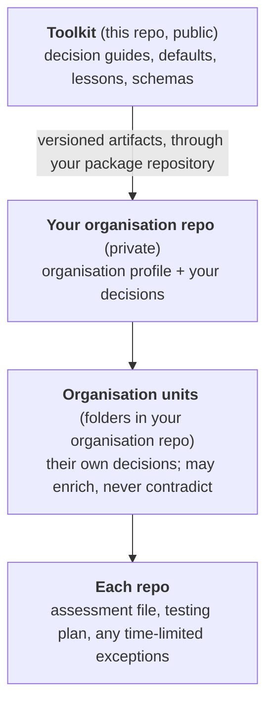

# under-test

[](https://github.com/fiftiesHousewife/under-test/actions/workflows/build.yml)
[](LICENSE)


[](docs/decisions/README.md)

**A toolkit for getting old code properly tested, one repo at a time.**

Many organisations have hundreds or thousands of repositories with few or weak tests. This toolkit helps a team,
working with AI coding assistance, find out what each repo needs, plan the work, and do it safely. It gives you:

- **Lessons on testing techniques**, each with a runnable before-and-after example and a short terminal video.
- **Decision guides:** one short record per choice the programme has to make, with the options and what follows.
- **Build conventions and tools** that measure test quality and apply good practice in every build.
- **A repo classifier** that says what kind of codebase a repo is, for people or for a survey tool to call.
- **AI assistant skills** that let an AI help with the work while a person reviews everything it produces.

The toolkit is **generic**: nothing in it is specific to one organisation, and it's designed to work inside locked-down
corporate networks.

## Where to start

| You are… | Read |
|---|---|
| Evaluating it for a company with a locked-down network (no internet installs, no public code hosting, your own package repository, proxy, tracker and wiki) | [docs/CORPORATE-USE.md](docs/CORPORATE-USE.md): the assumptions it is built for, and how each part reaches people |
| Ready to adopt it in your organisation | [ADOPTION.md](ADOPTION.md): step by step, from naming roles to rolling out in batches |
| Learning a testing technique | [techniques/](techniques/README.md): lessons, runnable examples and videos |
| Making or reviewing a programme decision | [docs/decisions/](docs/decisions/README.md): decision guides, smallest first |
| An AI coding assistant, or directing one | [AGENTS.md](AGENTS.md): how to work in this repo, and the code standards |
| Unsure of a word | [GLOSSARY.md](GLOSSARY.md) |

## Adopting it, in brief

You never change or fork this repo to use it. Your organisation keeps its own facts and choices in a separate, private
**organisation repo**, and receives the toolkit by version number through its own package repository.



- **Your environment stays yours.** Proxy, package repository, JDK and credentials remain in your existing Gradle or
  Maven set-up.
- **Your standards stay yours.** Use the toolkit's code-quality rules, your own rule files, or your own plugin
  (`underTest.codeStyle`). The testing evidence the programme relies on always runs.
- **Your platforms stay yours.** Issue tracker, CI, code hosting and AI assistant are named in your organisation
  profile; the toolkit adapts to them.

Full detail: [ADOPTION.md](ADOPTION.md) and [docs/CORPORATE-USE.md](docs/CORPORATE-USE.md).

## Try it

You need JDK 25. The Gradle wrapper fetches everything else.

```bash
git clone https://github.com/fiftiesHousewife/under-test.git
cd under-test
./gradlew check
```

`check` runs the tests and every quality check: coverage, style, complexity, copy-paste detection, bug and
security-bug analysis (SpotBugs with FindSecBugs), and forbidden APIs. See
[the code standards](AGENTS.md#code-standards-enforced-by-gradlew-check).

### See mutation testing catch weak tests

The [mutation testing lesson](techniques/mutation-testing/README.md) has two test suites with the same 100% line
coverage. One catches bugs; the other doesn't:

```bash
./gradlew :techniques:mutation-testing:pitest -Psuite=weak   # 5 of 13 deliberately introduced bugs caught
./gradlew :techniques:mutation-testing:pitest                # 13 of 13 caught
```

The difference comes down to tests like these:

```java
// Weak: passes for any positive discount, so a wrong percentage goes unnoticed
assertTrue(calc.discountPercent(200, false) > 0);

// Strong: checks both sides of each boundary, and reports every failure at once
assertAll(
        () -> assertThat(calc.discountPercent(49, false)).isZero(),
        () -> assertThat(calc.discountPercent(50, false)).isEqualTo(5),
        () -> assertThat(calc.discountPercent(100, false)).isEqualTo(10));
```

## Lessons and videos

Each lesson has a short terminal video generated from a script, with captions and a spoken voiceover produced from
the same narration text, so videos never drift from the code. Organisations receive them as editable layers (silent
video, narration audio and script, captions) to rebrand, trim or revoice; see
[docs/CORPORATE-USE.md](docs/CORPORATE-USE.md#lessons-and-videos-rebranding-trimming-and-revoicing).

## Surveying many repos

Surveying every repo in an organisation is outside this toolkit. Its repo classifier works on one repo and writes a
result in [a published format](schema/repo-classification.schema.json), so any survey tool can call it.
[A design for such a tool](docs/design/survey-tool.md) shows how to survey a GitHub organisation.

## What's in this repo

| Folder | What you'll find |
|---|---|
| [`ADOPTION.md`](ADOPTION.md), [`docs/CORPORATE-USE.md`](docs/CORPORATE-USE.md) | How to adopt the toolkit, and the corporate environment it is built for |
| [`techniques/`](techniques/README.md) | One folder per testing technique: lesson, runnable example, video, and the rules for when to use it |
| [`docs/decisions/`](docs/decisions/README.md) | Decision guides, one small decision each, building from foundations upward |
| [`docs/design/`](docs/design/survey-tool.md) | Designs for tools that sit outside the toolkit |
| [`docs/REFERENCES.md`](docs/REFERENCES.md) | Background reading and sources |
| [`GLOSSARY.md`](GLOSSARY.md) | The words we use, the words we avoid, the engagement roles and phases |
| [`examples/organisation-repo/`](examples/organisation-repo/README.md) | The shape of an organisation repo, with placeholder values |
| [`schema/`](schema/) | JSON Schemas for every YAML and JSON format the toolkit reads or writes |
| [`tools/`](tools/) | Tools, including [the backlog importers](tools/backlog-import/README.md) |
| [`plan/backlog-seed.yaml`](plan/backlog-seed.yaml) | The starting list of work, to import into your issue tracker |
| [`build-logic/`](build-logic/), [`config/quality/`](config/quality/) | Gradle conventions and quality-check rules |
| [`AGENTS.md`](AGENTS.md) | How AI coding assistants, and people, should work here |

## Licence

Apache License 2.0, for everything in this repository: code, tools, guides, lessons and videos. See [LICENSE](LICENSE)
and [NOTICE](NOTICE).

## Contributing

Read [AGENTS.md](AGENTS.md) and [GLOSSARY.md](GLOSSARY.md) first. In short: plain English, refer to things by name with
a link, a schema for every YAML file, nothing organisation-specific, and `./gradlew check` must pass.
