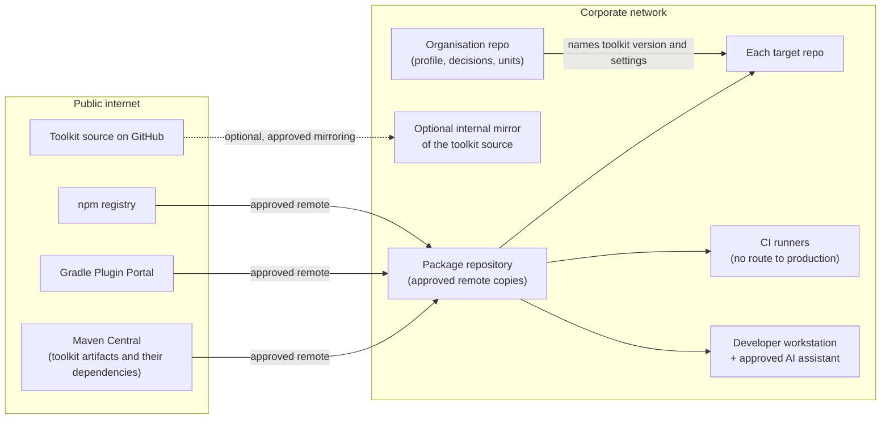

# Using the toolkit inside a corporate network

This document describes the environment the toolkit is designed for: a large company with locked-down networks, fixed
platforms and formal approval for anything new. It lists the assumptions, then shows how each part of the toolkit
reaches people and is used day to day. For the adoption steps themselves, see [ADOPTION.md](../ADOPTION.md).

The assumptions are deliberately strict. If your organisation is more open, everything here still works; you just have
more options.

---

## Representative assumptions

### Network
- **No direct internet access** from workstations, build agents or servers. All outbound traffic goes through an
  authenticated proxy, and only to an allowlist.
- **No access to public code-hosting sites** (github.com, gitlab.com). Public source code can't be cloned, and links to
  it in documentation don't open.
- **Package downloads go only through the organisation's package repository** (for example Artifactory or Nexus),
  which keeps approved remote copies of Maven Central, the Gradle Plugin Portal, npm and sometimes PyPI. Builds never
  talk to those public sites directly.

### Software
- **Nothing is installed from the internet.** No `curl | sh`, no Homebrew, no `npx` of unapproved packages, no
  installers from vendor websites. Developer tools come from an approved software catalogue, installed by a central
  team.
- **New libraries and tools need approval:** a security review (known vulnerabilities, licence, maintainer), then
  publication in the package repository. This takes weeks, not minutes, so every new dependency is a cost.
- **Developers can't install system software** and usually don't have administrator rights.

### Workstations
- **Windows laptops**, often without WSL2 or any container runtime.
- An approved JDK, an approved IDE, the company's Git client, and one approved AI assistant.

### Platforms (all fixed; the toolkit fits around them)
| Concern | Typical situation |
|---|---|
| Code hosting | An internal instance (for example GitHub Enterprise Server, Bitbucket Data Center, GitLab self-managed) |
| CI | An internal platform, often on Kubernetes, with no Docker daemon in build pods |
| Image builds | A daemon-less builder (for example Buildah or Kaniko) |
| Deployment | An internal release tool with its own records of what is deployed where |
| Issue tracking | An enterprise tracker (for example Jira, cloud or self-hosted), often with a rule that every commit names a work item |
| Knowledge | An internal wiki (for example Confluence), test-management tools and regression packs |
| Secrets | A vault; production secrets should never be in repos, but sometimes are |
| AI assistant | One approved assistant (for example GitHub Copilot), with organisation policies; no unattended agents |

### Governance
- **Change control** for production systems, and separation between production and non-production networks, which is
  sometimes imperfect.
- **Named owners** at every level of the organisation chart, with their own standards and approval rights.
- **Audit:** decisions and approvals must be traceable.

---

## How the toolkit fits

### What crosses the boundary, and how

Only versioned artifacts cross into the network, through routes that already exist. Nothing at build time or run time
reaches the internet.

| Toolkit part | Reaches people as | Through |
|---|---|---|
| Convention plugin (quality checks, testing evidence, `underTest` settings) | Versioned Gradle plugin artifact | Package repository |
| Skills for the AI assistant | Versioned skills bundle, unpacked by `./gradlew installSkills` | Package repository |
| Decision guides, schemas, technique rules | Versioned content bundle | Package repository |
| Lessons with runnable examples | The content bundle, or the internal source mirror | Package repository or code hosting |
| Organisation profile and decisions | Files in the organisation repo | Internal code hosting |
| Third-party tools the checks use (Checkstyle, PMD, SpotBugs, FindSecBugs, JaCoCo, PIT, forbidden APIs) | Ordinary Maven artifacts | Package repository |

### Keeping the approval cost low

Because each new dependency needs a security review, the toolkit:

- **reuses tools organisations usually already approve** (the standard Gradle quality plugins, JUnit, AssertJ,
  SpotBugs) rather than introducing new ones;
- **avoids extra plugins where a tool can be run directly** (for example, PMD's own copy-paste detector instead of a
  separate plugin);
- **will publish a list of every external artifact it uses**, with versions and licences, with each release, so a
  security team can approve them in one pass;
- **doesn't need Docker, Python, Node or any command-line tool beyond Java and Git** for its core use. Where a tool
  currently needs more (see the gaps below), a Java-only version is planned.

### Build environment

Proxy, package repository, credentials and JDK locations stay in the organisation's existing build set-up: a Gradle
init script and `gradle.properties` in the Gradle user home, or Maven's `settings.xml`. The toolkit never sets them. In
practice:

- the Gradle wrapper points at an internal copy of the Gradle distribution;
- automatic JDK download is switched off (`org.gradle.java.installations.auto-download=false`) and Gradle uses the
  approved, installed JDK;
- the init script replaces public repositories with the package repository, and can set `underTest.*` settings for
  every build.

### Issue tracker and knowledge tools

- The programme backlog and each repo's work live in the organisation's tracker, whichever it is. The toolkit provides
  importers with an adapter per tracker. Credentials come from the person's environment, never from files.
- If every commit must name a work item, the organisation profile says so. The AI assistant then includes the key, and
  the build checks commit messages.
- Knowledge sources (wiki pages, regression packs, test-management exports, tracker history) stay inside the
  organisation. People choose which ones to feed into specification work; the toolkit never fetches them on its own.

### AI assistant

- Only the organisation's approved assistant is used, with the skills bundle installed into the folders it reads.
- A person directs it and reviews everything it produces. Unattended agents stay off unless the organisation profile
  allows them.
- AI-written tests must pass the acceptance check before they are kept.

### Containers and production safety

- Developer machines may have no container runtime, so container tests skip themselves locally and run in CI.
- CI on Kubernetes has no Docker daemon. The organisation chooses how container tests run there (for example kubedock
  or rootless Podman) and records it in its organisation repo.
- Old repos are scanned for secrets before anything builds or runs them, and their first runs happen only on runners
  that can't reach production.

---

## Lessons and videos: rebranding, trimming and revoicing

Lesson videos are generated from scripts in the toolkit's own CI and published with each release. Each one ships as
**separate layers**, so you can make it your own without re-recording anything:

| Layer | File | Use it to |
|---|---|---|
| Finished video | `<lesson>.mp4` | Use as-is |
| Silent screen recording | `<lesson>.silent.mp4` | Put your own voice or music under it |
| Narration audio | `<lesson>.narration.m4a`, and one clip per step | Re-time or replace parts of the voice |
| Narration script | `<lesson>.narration.md`, one line per step | Change wording to your terms, translate it, or record a person reading it |
| Captions | `<lesson>.vtt`, `<lesson>.srt` | Subtitles in any player or editor; regenerated from the script |
| Source | `<lesson>.tape` | Re-render the screen recording |
| Quick-look animation | `<lesson>.gif` (silent) | Embed in wiki pages |

### Three ways to customise

1. **In a video editor you already use** (for example Camtasia, Premiere Pro or Clipchamp). Import the silent recording,
   narration audio and captions as separate tracks, then add your intro and outro, trim, or replace the voice. No new
   tools needed.
2. **Revoice.** Have a person record the narration script, or run it through your approved text-to-speech service.
   Captions don't need redoing: they come from the same script. If you change the script's wording, regenerate the
   captions from it.
3. **Rebrand automatically at every release.** Keep a branding file in your organisation repo naming your intro clip,
   outro clip, voice and caption style. A small step built on ffmpeg adds your intro and outro and combines the layers,
   so each new toolkit release gives you branded videos without manual editing. (Planned; see the backlog.)

Your branding and edited videos live in your organisation repo or your own media library, never in the toolkit.

### What you need, and what you don't

- **To watch or edit:** nothing new; the files play in browsers, wikis and video tools.
- **To revoice or rebrand automatically:** ffmpeg, which many organisations already approve, and optionally your
  approved text-to-speech service.
- **To make your own lesson videos, or re-render the toolkit's:** VHS. Most organisations won't need it. If you do:
  1. Mirror VHS's official container image (`ghcr.io/charmbracelet/vhs`, MIT licence), which already includes its
     helpers (`ttyd` and `ffmpeg`), through your container registry, like any other approved image.
  2. Run it as the image of a CI job. On Kubernetes-based CI the job runs inside the image, so no Docker daemon is
     needed. The job runs `vhs lesson.tape` and keeps the MP4 and GIF as outputs.
  3. For voice and captions too, mirror narratty's image (`ghcr.io/ditschi/narratty`, MIT licence), which bundles VHS,
     the Kokoro voice (Apache-2.0) and ffmpeg.
  4. People write and edit the `.tape` and narration files on their own machines, with no container runtime needed;
     CI renders the video, just as it runs container tests.

  Other routes, such as `go install` through a mirrored Go module proxy, or Charm's own Linux package repository, are
  usually harder to get approved.

### Licence

Everything in the toolkit, videos and their layers included, is under the Apache License 2.0. You may use, change,
rebrand and redistribute it freely; when you redistribute, keep the licence and notices and mark the files you changed.

*Background:* [Lesson videos ship as editable layers so organisations can rebrand, trim and revoice them](decisions/0017-lesson-videos-ship-as-editable-layers-so-organisations-can-rebrand-trim-and-revoice-them.md).

---

## A day in the life

| Who | What they do | Tools they touch |
|---|---|---|
| **Toolkit Owner** | Approves a new toolkit release, raises the version in the organisation repo by pull request, passes the external artifact list to security | Package repository, organisation repo |
| **Technical Architect** | Sets `underTest` settings in the init script; records how container tests run on the CI platform | Init script, organisation repo |
| **Test Quality Lead** | Agrees thresholds, approves exceptions, reviews AI-written test checks | Organisation repo, tracker |
| **Forward Deployed Engineer** | Measures a repo, drafts its testing plan with the AI assistant, writes tests, raises pull requests that each name a work item | Workstation, AI assistant, tracker |
| **Application Owner** | Approves the repo's testing plan and signs off the batch | Code hosting, tracker |
| **Subject-matter expert** | Answers questions about business rules; confirms expected results | Tracker or wiki, review sessions |

---

## Gaps today

These are being worked on; each has an item in the backlog.

| Gap | Effect in a corporate network | Plan |
|---|---|---|
| The backlog importer needs Python (no longer the GitHub CLI; it calls the REST API) | Python may be unavailable | A Java-only loader with GitHub and Jira adapters |
| No Jira adapter yet | Jira organisations must use the tracker's own bulk import | Jira Cloud adapter |
| Convention plugin, skills bundle and content bundle not yet published | Organisations would build them from an internal copy of the source | Publish to Maven Central with each release |
| APM (Agent Package Manager) is used for this repo's own external skills | APM usually isn't allowed | Skills bundle through the package repository; APM optional |
| External artifact list not yet generated | Security review has to compile it by hand | Generated with each release |

---

## Checklist for a security review

- [ ] The list of external artifacts and licences for the toolkit version (from the release).
- [ ] Confirmation that builds resolve only from the package repository (no direct internet access).
- [ ] Confirmation that no unattended AI agents are enabled.
- [ ] Confirmation that old repos are secret-scanned and run first only on runners with no route to production.
- [ ] The organisation profile, reviewed by the Security and Platform Owner.
