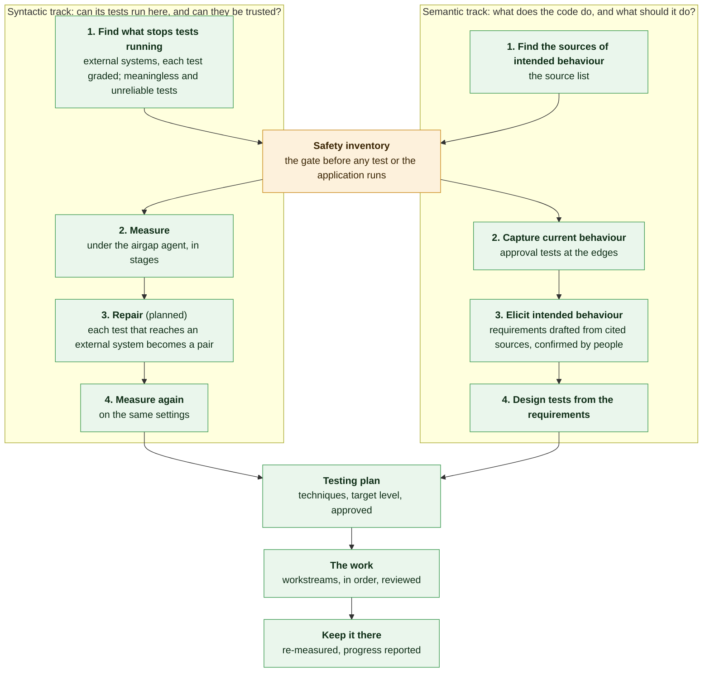

# The journey of one repo, and the decisions behind each step

Each step says who does it, what it leaves in the repo, and which decision guides settle how. The guides hold the detail; this page summarises them, and links every one, so the two stay in step. The [README](../README.md) has the short version.

A repo goes through two tracks side by side, and they join at the testing plan
([why](decisions/0092-the-journey-runs-two-tracks-syntactic-and-semantic-that-join-at-the-testing-plan.md)):

- **The syntactic track** asks: can its tests run here, and can they be trusted? It finds what stops the tests
  running, measures them, repairs the ones that reach external systems, and measures again.
- **The semantic track** asks: what does the code do, and what should it do? It finds the sources of intended
  behaviour, captures current behaviour, elicits intended behaviour, and designs tests from it.

The first step of each track runs nothing of the repo's but its build. The safety inventory is the gate between that
step and the rest of both tracks. Within each track the steps run in order; between them, a step waits only for what it
reads from the other, and the repo's code first runs in measurement. The testing plan takes what both tracks found; the
work and keeping it there follow.

[The journey as a drawing](design/repo-journey.excalidraw), with each skill, decision and path back: open it in
Excalidraw.

The first step of both tracks together is **discovery**: nothing of the repo's runs but its build, which may resolve
dependencies and compile without running a test
([why](decisions/0073-a-repo-may-be-built-without-running-its-tests-before-the-safety-gate.md)), and nothing found is
copied anywhere if it is a secret
([why](decisions/0069-the-safety-inventory-is-a-gate-before-the-first-run-and-no-skill-ever-copies-a-secret.md)). What
a program can decide the same way every time is done by a tool; the skills keep the judgement
([why](decisions/0075-a-skills-mechanical-steps-are-done-by-deterministic-tools-and-the-skill-keeps-only-judgement.md)).
[Discovery, step by step](design/discovery.md) shows which skill finds what and which files each writes.

## The gate before both tracks: the safety inventory

Before any test or the application runs, find what could reach production or real data
([why](decisions/0069-the-safety-inventory-is-a-gate-before-the-first-run-and-no-skill-ever-copies-a-secret.md)). It
can run alongside the first step of each track, and must be settled before the second step of either. The
[run-the-safety-inventory](../.github/skills/run-the-safety-inventory/SKILL.md) skill turns gitleaks' scan of the whole
history, and a list of keystores ever committed, into the assessment file's safety section. The repo is also searched
for private keys, production credentials in its settings, real personal data in fixtures and dumps, jobs that start by
themselves, database migrations that run at start-up, build tasks that publish or deploy, fixed file paths and Windows
file shares, and native libraries. Secrets, keys, production credentials and real personal data block every run until
they're resolved, and a real production secret is handled as a security incident. The rest are made harmless in the
test profile or the build, and recorded.

When code does run, it is only where production can't be reached: in CI on runners with no route out, and, once the
organisation has approved the machines, on an engineer's own machine under the
[airgap agent](https://github.com/fiftiesHousewife/under-test-airgap), which refuses every call to another machine and
reports it, and allows calls that stay on the test's own machine
([why](decisions/0090-only-a-system-on-another-machine-reaches-out-and-a-test-needing-a-service-on-its-own-machine-is-found-by-failing.md)).
The test profile, with dummy secrets, is added in this step, and the findings that don't block are made harmless in it;
from then on the repo runs with it by default. A check that stops tests at once if any configured address belongs to
production comes later, with the convention plugin. The field trial's public repos, used only to check the toolkit's
own tools, are the one exception: their tests run under the airgap agent, refusing every call to another machine,
without a safety inventory first
([why](decisions/0089-the-field-trials-public-repos-run-their-tests-under-the-airgap-agent-without-a-safety-inventory-first.md)).

- **Who:** a Forward Deployed Engineer, with the run-the-safety-inventory skill; the Security and Platform Owner
  decides blocking findings and approves anything accepted rather than fixed.
- **Leaves in the repo:** the inventory's findings in the assessment file; a test profile; a `.gitleaksignore` with
  reasons.
- **Decided in:** [Before any test or application runs, a safety inventory records what could reach production or real data, and some findings block the run](../decision-guides/0057-before-any-test-or-application-runs-a-safety-inventory-records-what-could-reach-production-or-real-data-and-some-findings-block-the-run.md), [No repo's tests or application run until its secrets scan is clean](../decision-guides/0007-no-repos-tests-or-application-run-until-its-secrets-scan-is-clean.md), [A production secret found in a repo is handled as a security incident](../decision-guides/0011-a-production-secret-found-in-a-repo-is-handled-as-a-security-incident.md), [Old code runs first only where production cannot be reached](../decision-guides/0008-old-code-runs-first-only-where-production-cannot-be-reached.md), [A test profile with dummy secrets is the default, and production profiles only work in production](../decision-guides/0010-a-test-profile-with-dummy-secrets-is-the-default-and-production-profiles-only-work-in-production.md), [Tests stop at once if any configured address is a production address](../decision-guides/0009-tests-stop-at-once-if-any-configured-address-is-a-production-address.md).

## The syntactic track: can its tests run here, and can they be trusted?

### 1. Find what stops tests running

Find what the code reaches and which of its existing tests can't run here or can't be trusted, before any of it runs.
This step keeps three lists of tests apart, each with one owner
([why](decisions/0080-discovery-keeps-three-lists-of-tests-apart-those-that-reach-external-systems-meaningless-tests-and-unreliable-tests.md)).

**Tests that reach external systems** come first, from the
[draft-the-external-systems-list](../.github/skills/draft-the-external-systems-list/SKILL.md) skill. It runs
[under-test-external-calls](https://github.com/fiftiesHousewife/under-test-external-calls), a tool that reads the code
and finds every reach point, where it opens or uses an external system (a database, an HTTP service, mail, a
directory, a queue, a socket), and every test that may reach one, with the chain of calls that gets there. The tool
grades each test's reach of each external system from the address the test's own settings give: **reaches** (its
settings name a host on another machine), **may reach** (the address is known only at run time) or **cannot reach**
(the call goes to a mock, an embedded server stands in, the settings give no address, or the address stays on the
test's own machine), and the skill reads the grade
([why the grades](decisions/0085-each-test-is-graded-reaches-may-reach-or-cannot-reach-from-the-address-its-own-settings-give.md);
[why the tool grades](decisions/0094-under-test-external-calls-grades-each-reach-and-the-external-systems-list-skill-reads-the-grade.md)).
An external system is one on another machine that a test cannot run without
([why](decisions/0098-an-external-system-is-one-on-another-machine-that-a-test-cannot-run-without.md)). The skill traces
each address to the code or the settings, or records where it will come from, and drafts the external systems list,
with a proposed stand-in for each and the addresses tests must never reach, for the Architecture Owner to confirm.
Each test's external systems, with the grade and its reason, go into the repo's list of tests
([why](decisions/0068-finding-what-the-code-connects-to-is-one-job-in-the-connection-list-skill-done-before-any-code-runs.md)).

Then the [find-meaningless-and-unreliable-tests](../.github/skills/find-meaningless-and-unreliable-tests/SKILL.md)
skill checks the repo's own tests with PMD and the toolkit's rules, in one pass, for the other two lists:
**meaningless tests**, that never run (disabled, or never picked up), can't fail (no real assertion, or a swallowed
failure) or check only their mocks; and **unreliable tests**, that sleep or depend on the order they run in. Each is
recorded and triaged, and no existing test is deleted before current behaviour is recorded.

- **Who:** a Forward Deployed Engineer; the Architecture Owner, and the Application Owner (for disabled tests).
- **Leaves in the repo:** `testing/external-systems.calm.json`, `testing/external-calls.json`, `testing/tests.yaml`, the
  meaningless and unreliable tests in the assessment file.
- **Decided in:** [Every repo starts with discovery: a draft external systems list, a source list and a check of its existing tests, and a first approval-test baseline follows](../decision-guides/0032-every-repo-starts-with-discovery-a-draft-external-systems-list-a-source-list-and-a-check-of-its-existing-tests-and-a-first-approval-test-baseline-follows.md), [Order of preference for test stand-in approaches](../decision-guides/0036-order-of-preference-for-test-stand-in-approaches.md), [Each application's external systems are recorded as a CALM list](../decision-guides/0030-each-applications-external-systems-are-recorded-as-a-calm-list.md), [The external systems list says what tests use for each system, and which addresses tests must never reach](../decision-guides/0031-the-external-systems-list-says-what-tests-use-for-each-system-and-which-addresses-tests-must-never-reach.md), [Meaningless and unreliable tests are recorded and triaged, and no existing test is deleted before the approval-test baseline exists](../decision-guides/0059-meaningless-and-unreliable-tests-are-recorded-and-triaged-and-no-existing-test-is-deleted-before-the-approval-test-baseline-exists.md).

### 2. Measure

Once the safety inventory allows it, the [measure-a-repo](../.github/skills/measure-a-repo/SKILL.md) skill is the first
time the repo's tests run, module by module, on a runner with no route out or under the airgap agent, through an init
script that changes nothing in the build. It goes in stages, each gating the next and each recorded, so a repo that
stops after any stage still has a result
([why](decisions/0070-measurement-runs-in-stages-each-gating-the-next-build-one-run-repeats-then-planted-bugs.md)):

1. **Build:** compile the code and tests; if it fails, fix the build first.
2. **One run:** every test once, leaving out the tests graded reaches; each test graded may reach is confirmed or
   cleared, a test graded cannot reach that does call out is something discovery missed and is added to the list, a
   connection error is sorted by where it was going, and a shared start-up that needs a stand-in is found
   ([why](decisions/0059-measurement-leaves-out-external-tests-varies-the-test-order-and-sorts-connection-errors-by-where-they-were-going.md)).
   A test that needs a service on its own machine that isn't running fails here, and is recorded as failing
   ([why](decisions/0090-only-a-system-on-another-machine-reaches-out-and-a-test-needing-a-service-on-its-own-machine-is-found-by-failing.md)).
3. **Repeats:** the tests that passed, four more times in varied orders, each failure rerun to confirm it, with
   coverage from JaCoCo: flaky and failing tests are recorded by name.
4. **Planted bugs:** PIT (mutation testing) on the tests that passed every time, per module, in key packages where it
   is large.

It also records the mix of test types. Scoring each obstacle to testing, with evidence, is the
[score-obstacles](../.github/skills/score-obstacles/SKILL.md) skill.

- **Who:** the measure-a-repo skill, run by a Forward Deployed Engineer.
- **Leaves in the repo:** the tests and level sections of `testing/assessment.yaml`, and flaky and failing tests in
  `testing/tests.yaml`. Results stay in the assessment file until a central store exists.
- **Decided in:** [The assessment file: where it lives, who writes which fields, and its schema version](../decision-guides/0023-the-assessment-file-where-it-lives-who-writes-which-fields-and-its-schema-version.md), [Where measured results are stored and how each repo sees its own](../decision-guides/0025-where-measured-results-are-stored-and-how-each-repo-sees-its-own.md), [How flaky tests are found](../decision-guides/0043-how-flaky-tests-are-found.md), [The named list of obstacles to testing and how each is scored](../decision-guides/0029-the-named-list-of-obstacles-to-testing-and-how-each-is-scored.md).

### 3. Repair (planned)

Repair makes the tests that reach external systems safe to run and still worth running, changing only test code
([why](decisions/0096-repair-pairs-each-test-that-reaches-an-external-system-after-measurement-changing-only-test-code.md)).
It takes the tests graded reaches and those measurement found calling out. Each becomes a pair from one set of test
bodies: one run injects the external system's stand-in and joins the normal runs, the other is tagged `external` and
runs against the real system on a schedule, where its test instance can be reached
([why](decisions/0086-every-test-that-reaches-an-external-system-becomes-a-pair-one-run-injects-a-stand-in-the-other-is-tagged-external.md)).
With JUnit 5 or 6 the pair is a test interface and two classes; with JUnit 4, where the repo must stay on it, a
parameterised class. For each external system, [under-test-tools](https://github.com/fiftiesHousewife/under-test-tools)
writes a work order from under-test-external-calls' record: which tests to pair, and where the stand-in goes (the first
method each test calls, whether it gets there through set-up, and the calls every test reaching the system shares)
([why](decisions/0095-repair-is-directed-by-a-work-order-per-external-system-that-under-test-tools-writes.md)). The
mechanical changes are made by OpenRewrite recipes, the rest by the AI, and a person reviews each, one external system
at a time ([why](decisions/0079-which-of-repairs-changes-openrewrite-recipes-make-and-which-the-ai-makes.md)).

What needs production code changed (a dependency a test can't replace, an address written in the code that a
stand-in needs in a setting) waits: it is recorded against its test, and the testing plan turns it into work
([why](decisions/0064-what-repair-does-where-a-test-that-reaches-an-external-system-has-no-place-to-inject-a-stand-in.md)).
The meaningless and unreliable tests the first step listed, confirmed by measurement, also become work in the testing
plan. A repaired test is kept only if it passes the checks for AI-written tests.

- **Who:** a Forward Deployed Engineer with the AI; a person reviews every change.
- **Leaves in the repo:** `testing/repair-orders.json`; the paired tests, the stand-ins they inject, the `external`
  tag on the half that reaches a real system, and in `testing/tests.yaml` each test's treatment and what was left for
  later.
- **Decided in:** [Tests that reach external systems are tagged and left out of normal runs](../decision-guides/0041-tests-that-reach-external-systems-are-tagged-and-left-out-of-normal-runs.md), [Order of preference for test stand-in approaches](../decision-guides/0036-order-of-preference-for-test-stand-in-approaches.md), [An in-process server the test starts is a stand-in, and comes first where developers' machines can't run containers](../decision-guides/0067-an-in-process-server-the-test-starts-is-a-stand-in-and-comes-first-where-developers-machines-cannot-run-containers.md), [The checks an AI-written test must pass before it is kept](../decision-guides/0047-the-checks-an-ai-written-test-must-pass-before-it-is-kept.md).

### 4. Measure again

The [measure-a-repo](../.github/skills/measure-a-repo/SKILL.md) skill runs again, on the same settings, once repair
and the first approval tests are done, so what they changed shows as a change: tests that now run, coverage and planted
bugs caught.

- **Who:** the measure-a-repo skill, run by a Forward Deployed Engineer.
- **Leaves in the repo:** updated tests and level sections in `testing/assessment.yaml`, and an updated
  `testing/tests.yaml`.
- **Decided in:** [The assessment file: where it lives, who writes which fields, and its schema version](../decision-guides/0023-the-assessment-file-where-it-lives-who-writes-which-fields-and-its-schema-version.md), [How flaky tests are found](../decision-guides/0043-how-flaky-tests-are-found.md).

## The semantic track: what does the code do, and what should it do?

### 1. Find the sources of intended behaviour

Find what says how the code should behave, before any of it runs. The Knowledge Curator lists the sources that count:
requirements, specifications, tickets, manuals, regression packs, wiki pages, tracker queries, other repos and the
people who know. The test assets that live outside the repo, such as automation suites run against a shared test
environment and manual test scripts, are sources too: they keep running where they are until repo tests cover the
same journeys, and never count as evidence. No skill does this step yet.

- **Who:** the Knowledge Curator, with a Forward Deployed Engineer.
- **Leaves in the repo:** the application's source list.
- **Decided in:** [Knowledge sources are listed by the knowledge curator and read through Allium skills with a citation addendum](../decision-guides/0034-knowledge-sources-are-listed-by-the-knowledge-curator-and-read-through-allium-skills-with-a-citation-addendum.md), [Each application also has a knowledge curator and an architecture owner](../decision-guides/0002-each-application-also-has-a-knowledge-curator-and-an-architecture-owner.md), [Test assets outside the repo are mined for behaviour, and kept running until repo tests replace them](../decision-guides/0058-test-assets-outside-the-repo-are-mined-for-behaviour-and-kept-running-until-repo-tests-replace-them.md), [Every repo starts with discovery: a draft external systems list, a source list and a check of its existing tests, and a first approval-test baseline follows](../decision-guides/0032-every-repo-starts-with-discovery-a-draft-external-systems-list-a-source-list-and-a-check-of-its-existing-tests-and-a-first-approval-test-baseline-follows.md).

### 2. Capture current behaviour

Once the safety inventory allows it, and after measurement has first run the repo's code
([why](decisions/0058-a-repos-code-first-runs-in-measurement-which-comes-before-capturing-current-behaviour-and-again-after-it.md)),
record a first baseline of what the code does today at its edges, as approval tests, before anything in the code
changes, so any later change in behaviour shows up. Their approval tests get the
same checks as any other test, and measurement's second run includes them; the record current behaviour workstream
extends them across the code. Behaviour is captured in order of preference: generated examples first, then recordings
of the code's outgoing calls in a test environment, then a recording inside the application in a test environment,
then copies from queues and batch files, then subsets of a test database; from production only with named approvals.
Everything captured is cleaned inside the environment it was captured in, before it's copied anywhere: secrets and
free text dropped, identifiers replaced by keyed substitutes, other personal data by invented values. A detector check
runs on every cleaned capture, a person signs off the first sample, and cleaned captures are still treated as personal
data unless the Data Protection Officer agrees otherwise. The cleaned captures become approval tests and recorded
responses. No skill does this step yet.

- **Who:** a Forward Deployed Engineer; the Security and Platform Owner and the data owner for where capture happens;
  the Data Protection Officer for the legal status.
- **Leaves in the repo:** the first approval tests and recorded responses, cleaned; the cleaning rules live in the
  shared test kit for each system.
- **Decided in:** [Black-box captures are taken in non-production first, and from production only with named approvals](../decision-guides/0060-black-box-captures-are-taken-in-non-production-first-and-from-production-only-with-named-approvals.md), [Order of preference for where current behaviour is captured](../decision-guides/0061-order-of-preference-for-where-current-behaviour-is-captured.md), [Captured data is cleaned inside the environment it was captured in, before it is copied anywhere](../decision-guides/0062-captured-data-is-cleaned-inside-the-environment-it-was-captured-in-before-it-is-copied-anywhere.md), [How personal data in captures is replaced: dropped, keyed substitutes or synthetic values, chosen per field](../decision-guides/0063-how-personal-data-in-captures-is-replaced-dropped-keyed-substitutes-or-synthetic-values-chosen-per-field.md), [Cleaned captures pass a detector check before they are kept, and a person signs off the first sample](../decision-guides/0064-cleaned-captures-pass-a-detector-check-before-they-are-kept-and-a-person-signs-off-the-first-sample.md), [Cleaned captures are treated as personal data unless the Data Protection Officer agrees they are anonymous](../decision-guides/0065-cleaned-captures-are-treated-as-personal-data-unless-the-data-protection-officer-agrees-they-are-anonymous.md).

### 3. Elicit intended behaviour

What the code does today isn't always what it should do. The AI drafts functional requirements from the listed
sources, citing a source for every one, and compares them with the approval tests; the Application Owner confirms each
requirement. Experts answer the differences in short, booked question sessions. Every remaining difference is an open
question that the Application Owner settles: keep today's behaviour as a known issue, fix it deliberately, or correct
the requirement. No skill does this step yet.

- **Who:** a Forward Deployed Engineer and the AI; subject-matter experts; the Application Owner.
- **Leaves in the repo:** the requirements, each citing its source, and their open questions.
- **Decided in:** [Current and intended behaviour are recorded side by side, and every difference is an open question](../decision-guides/0033-current-and-intended-behaviour-are-recorded-side-by-side-and-every-difference-is-an-open-question.md), [Expert time is booked as a budget of short question sessions](../decision-guides/0035-expert-time-is-booked-as-a-budget-of-short-question-sessions.md).

### 4. Design tests from the requirements

For each confirmed requirement that no test checks today, design the tests that would: the kind of test, the
examples, and the expected results the requirement gives. They become the plan's work for the test against
requirements workstream. No skill does this step yet.

- **Who:** a Forward Deployed Engineer and the AI; the Test Quality Lead for the kind of test.
- **Leaves in the repo:** the designed tests, each naming its requirement, for the testing plan.
- **Decided in:** [Current and intended behaviour are recorded side by side, and every difference is an open question](../decision-guides/0033-current-and-intended-behaviour-are-recorded-side-by-side-and-every-difference-is-an-open-question.md), [Progress is measured by required tests met, alongside coverage and mutation results](../decision-guides/0014-progress-is-measured-by-required-tests-met-alongside-coverage-and-mutation-results.md).

## Where the tracks join

### The testing plan

The repo's target test maturity level follows from its business criticality. The
[choose-techniques](../.github/skills/choose-techniques/SKILL.md) skill marks each technique adopt, defer or reject
for the repo from its rules and the measurements. The
[write-the-testing-plan](../.github/skills/write-the-testing-plan/SKILL.md) skill generates the testing plan from the
assessment file, taking both tracks: what repair left, the meaningless and unreliable tests, the techniques' work, and
the tests designed from requirements. It is never edited by hand, and the Application Owner approves it in one pull
request. The [load-repo-work-into-the-issue-tracker](../.github/skills/load-repo-work-into-the-issue-tracker/SKILL.md)
skill then loads its work into the organisation's issue tracker, one item per piece of work, and the tracker follows
the work from there.

- **Who:** the Test Quality Lead and a Forward Deployed Engineer; the Application Owner approves.
- **Leaves in the repo:** decisions in `testing/assessment.yaml`, and `testing/TESTING-PLAN.md`.
- **Decided in:** [What each test maturity level means](../decision-guides/0012-what-each-test-maturity-level-means.md), [Target test maturity level for each business criticality](../decision-guides/0015-target-test-maturity-level-for-each-business-criticality.md), [Testing plans are generated from the assessment file, and the issue tracker follows the work](../decision-guides/0024-testing-plans-are-generated-from-the-assessment-file-and-the-issue-tracker-follows-the-work.md), [Who approves repo and application testing plans](../decision-guides/0026-who-approves-repo-and-application-testing-plans.md), [Repo work is tracked in the organisation's issue tracker with standard labels](../decision-guides/0027-repo-work-is-tracked-in-the-organisations-issue-tracker-with-standard-labels.md), [Shared libraries target level 4, whatever the criticality of the apps using them](../decision-guides/0016-shared-libraries-target-level-4-whatever-the-criticality-of-the-apps-using-them.md), [How an application's test maturity level is worked out from its repos](../decision-guides/0017-how-an-applications-test-maturity-level-is-worked-out-from-its-repos.md), [Target test mix for each application type and the top-heavy phase at level 2](../decision-guides/0018-target-test-mix-for-each-application-type-and-the-top-heavy-phase-at-level-2.md), [When the organisation requires it, every commit names its work item](../decision-guides/0028-when-the-organisation-requires-it-every-commit-names-its-work-item.md).

### The work

The work takes what repair left, and the plan's own pieces of work, in a fixed order of workstreams: make it run on
its own, fix flaky tests, record current behaviour, make code testable, test against requirements, strengthen tests,
check in production; key-journey code and high-risk files first. For each external system, the first stand-in that
fits is used: a container, recorded responses, a contract with the other team, a fake behind an interface. People
write the tests with AI help. An AI-written test is kept only once it passes the acceptance check (it compiles; passes
five runs in a row with outbound calls blocked; raises coverage of its target or catches a planted bug that nothing
caught before; is labelled as AI-written; and asserts more than "is not null"), and a person reviews every one. A test
that expects different behaviour goes to triage, not the bin. No meaningless or unreliable test is deleted before the
approval-test baseline exists.

- **Who:** Forward Deployed Engineers with AI coding assistance; the Test Quality Lead sets the checks.
- **Leaves in the repo:** the tests, and any time-limited exceptions to a decision.
- **Decided in:** [The order of workstreams for a repo](../decision-guides/0050-the-order-of-workstreams-for-a-repo.md), [Order of preference for test stand-in approaches](../decision-guides/0036-order-of-preference-for-test-stand-in-approaches.md), [People do the work with AI coding assistance, and review everything it produces](../decision-guides/0005-people-do-the-work-with-ai-coding-assistance-and-review-everything-it-produces.md), [The checks an AI-written test must pass before it is kept](../decision-guides/0047-the-checks-an-ai-written-test-must-pass-before-it-is-kept.md), [AI-written tests that expect different behaviour go to triage, not the bin](../decision-guides/0048-ai-written-tests-that-expect-different-behaviour-go-to-triage-not-the-bin.md), [Independent AI agents working unattended are a future direction only](../decision-guides/0006-independent-ai-agents-working-unattended-are-a-future-direction-only.md), [How strict the checks on AI-written tests are at the start](../decision-guides/0049-how-strict-the-checks-on-ai-written-tests-are-at-the-start.md), [Differential tests replay saved requests offline, and live comparison runs only on read-only traffic](../decision-guides/0066-differential-tests-replay-saved-requests-offline-and-live-comparison-runs-only-on-read-only-traffic.md), [Meaningless and unreliable tests are recorded and triaged, and no existing test is deleted before the approval-test baseline exists](../decision-guides/0059-meaningless-and-unreliable-tests-are-recorded-and-triaged-and-no-existing-test-is-deleted-before-the-approval-test-baseline-exists.md).

### Keep it there

Progress is measured by required tests met (one of the right kind for each external system, and passing tests for
each requirement), alongside coverage and mutation results. Changed repos are re-scanned nightly, and repos in the
current batch re-measured monthly and whenever a workstream finishes. Mutation testing in pull requests only reports
at first. Once the target level is reached, the repo is handed over.

- **Who:** the measure-a-repo skill, run by a Forward Deployed Engineer; the Engagement Lead reports progress; the
  Application Owner accepts the results.
- **Leaves in the repo:** an up-to-date assessment file, which holds the repo's results until a central store exists.
- **Decided in:** [Progress is measured by required tests met, alongside coverage and mutation results](../decision-guides/0014-progress-is-measured-by-required-tests-met-alongside-coverage-and-mutation-results.md), [What counts as evidence for each test maturity level](../decision-guides/0013-what-counts-as-evidence-for-each-test-maturity-level.md), [How often repos are re-scanned and re-measured](../decision-guides/0056-how-often-repos-are-re-scanned-and-re-measured.md), [Mutation testing in pull requests reports only at first](../decision-guides/0055-mutation-testing-in-pull-requests-reports-only-at-first.md).

## At every step

The [render-the-assessment-report](../.github/skills/render-the-assessment-report/SKILL.md) skill shows the repo's
files as one report page, and applies the choices people paste back.

## Rules the work follows throughout

- **Where tests run:** [Tests are split by what they need: local tests and container tests](../decision-guides/0019-tests-are-split-by-what-they-need-local-tests-and-container-tests.md); [How CI runs container tests for each kind of CI platform](../decision-guides/0020-how-ci-runs-container-tests-for-each-kind-of-ci-platform.md); [Container tests on developer machines that have no container runtime](../decision-guides/0021-container-tests-on-developer-machines-that-have-no-container-runtime.md); [How developers see container test results while their machines cannot run containers](../decision-guides/0022-how-developers-see-container-test-results-while-their-machines-cannot-run-containers.md).
- **Standing in for real systems:** [Contract tests share pacts as versioned artifacts through the package repository, without a broker](../decision-guides/0037-contract-tests-share-pacts-as-versioned-artifacts-through-the-package-repository-without-a-broker.md); [An in-memory database of a different product never counts as evidence](../decision-guides/0038-an-in-memory-database-of-a-different-product-never-counts-as-evidence.md); [Recorded responses and fakes live in shared test kits, not in each repo](../decision-guides/0039-recorded-responses-and-fakes-live-in-shared-test-kits-not-in-each-repo.md); [Who owns and maintains each shared test kit](../decision-guides/0040-who-owns-and-maintains-each-shared-test-kit.md); [Tests that reach external systems are tagged and left out of normal runs](../decision-guides/0041-tests-that-reach-external-systems-are-tagged-and-left-out-of-normal-runs.md); [Whether a shared test environment can count as evidence for a limited time](../decision-guides/0042-whether-a-shared-test-environment-can-count-as-evidence-for-a-limited-time.md).
- **Keeping tests healthy:** [How flaky tests are found](../decision-guides/0043-how-flaky-tests-are-found.md); [Flaky tests can be quarantined only with an expiry date](../decision-guides/0044-flaky-tests-can-be-quarantined-only-with-an-expiry-date.md); [Personal data is removed from any recorded traffic or data](../decision-guides/0046-personal-data-is-removed-from-any-recorded-traffic-or-data.md).
- **Feature flags:** [Feature flags use the OpenFeature standard with the organisation's own flag product](../decision-guides/0004-feature-flags-use-the-openfeature-standard-with-the-organisations-own-flag-product.md); [Feature flags are used to change legacy code safely and to release gradually](../decision-guides/0051-feature-flags-are-used-to-change-legacy-code-safely-and-to-release-gradually.md); [Every feature flag state in use is tested and old flags are removed](../decision-guides/0045-every-feature-flag-state-in-use-is-tested-and-old-flags-are-removed.md).

A repo that is no longer deployed or changed skips all this: it gets a
[retirement review](../decision-guides/0052-repos-no-longer-deployed-or-changed-get-a-retirement-review-not-a-testing-plan.md)
instead of a testing plan.

## Across the whole organisation

One repo's journey repeats across all of them, in five phases, each ending with a sign-off:

1. **Set-up:** roles named, the toolkit brought inside the network, the organisation repo created, the decision
   guides answered, production made safe.
2. **Finding out what repos we have:** each repo classified by technology stack and application type.
3. **Pilots:** one application per common pairing of technology stack and application type is taken through the
   journey by hand, and what it teaches becomes that organisation's testing guides.
4. **Rolling out in batches:** each batch sits within one part of the organisation; high-criticality applications,
   the commonest pairings, the external systems and libraries the most repos use go first.
5. **Handing over:** the organisation's own teams run the batches, and the Toolkit Owner role moves to them.

Decided in: [The programme runs as a forward deployed engagement with named roles](../decision-guides/0001-the-programme-runs-as-a-forward-deployed-engagement-with-named-roles.md), [The programme moves through five phases, each ending with a sign-off](../decision-guides/0003-the-programme-moves-through-five-phases-each-ending-with-a-sign-off.md), [One pilot application per common technology stack and application type pair](../decision-guides/0053-one-pilot-application-per-common-technology-stack-and-application-type-pair.md), [How each batch of repos is chosen](../decision-guides/0054-how-each-batch-of-repos-is-chosen.md).

