# The journey of one repo, and the decisions behind each step

Each step says who does it, what it leaves in the repo, and which decision guides settle how. The guides hold the detail; this page summarises them, and links every one, so the two stay in step. The [README](../README.md) has the short version.

[The journey as a drawing](design/repo-journey.excalidraw), with each decision and the paths back: open it in
Excalidraw.

```mermaid
%%{init: {"flowchart": {"wrappingWidth": 230, "nodeSpacing": 28, "rankSpacing": 36}}}%%
flowchart LR
    D["<b>1. Discovery</b><br/>external systems list · meaningless and unreliable tests · source list; only the build runs"] --> S["<b>2. Safety inventory</b><br/>the gate before the first run: secrets, real data, jobs that start themselves"]
    S --> M["<b>3. Measurement</b><br/>the first run, in stages: build, one run, repeats, planted bugs"]
    M --> R["<b>4. Repair</b><br/>each test reaching an external system twinned: stand-in and real, test code only"]
    R --> C["<b>5. Capture current behaviour</b><br/>capture, clean in place, check, approval tests, then measure again"]
    C --> B["<b>6. Intended behaviour</b><br/>specification from sources and experts"]
    B --> P["<b>7. Testing plan</b><br/>techniques, target level, approved"]
    P --> W["<b>8. The work</b><br/>workstreams, in order, reviewed"]
    W --> K["<b>9. Keep it there</b><br/>re-measured, progress reported"]
    classDef step fill:#eaf6ec,stroke:#3c9a52,color:#0f2e17
    class D,S,C,M,R,B,P,W,K step
```

## 1. Discovery

Find out what the code talks to and what tests it already has, before any of it runs. Nothing of the repo's runs but
its build, which may resolve dependencies and compile without running a test
([why](decisions/0073-a-repo-may-be-built-without-running-its-tests-before-the-safety-gate.md)), and nothing found is
copied anywhere if it is a secret ([why](decisions/0069-the-safety-inventory-is-a-gate-before-the-first-run-and-no-skill-ever-copies-a-secret.md)).

Discovery keeps three lists of tests apart, each with one owner
([why](decisions/0080-discovery-keeps-three-lists-of-tests-apart-those-that-reach-external-systems-meaningless-tests-and-unreliable-tests.md)).
**Tests that reach external systems** come first, from the
[draft-the-external-systems-list](../.github/skills/draft-the-external-systems-list/SKILL.md) skill, to be renamed for the
external systems list ([why](decisions/0081-external-system-replaces-the-word-connection.md)). It runs
[connection-paths](https://github.com/fiftiesHousewife/connection-paths), a tool that reads the code and finds every
reach point, where it opens or uses an external system (a database, an HTTP service, mail, a directory, a queue, a
socket), and every test that may reach one, with the chain of calls that gets there. The skill traces each address to
the code or the settings, or records where it will come from, and drafts the external systems list, with a proposed
stand-in for each and the addresses tests must never reach, for the Architecture Owner to confirm. Each test's
external systems go into the repo's list of tests ([why](decisions/0068-finding-what-the-code-connects-to-is-one-job-in-the-connection-list-skill-done-before-any-code-runs.md)).
Then the [find-meaningless-and-unreliable-tests](../.github/skills/find-meaningless-and-unreliable-tests/SKILL.md) skill, to be renamed for what it
now finds, checks the repo's own tests with PMD and the toolkit's rules, in one pass, for the other two lists:
**meaningless tests**, that never run (disabled, or never picked up), can't fail (no real assertion, or a swallowed
failure) or check only their mocks; and **unreliable tests**, that sleep or depend on the order they run in. Each is
recorded and triaged, and no existing test is deleted before current behaviour is recorded. The Knowledge Curator lists
the sources that count: regression packs, wiki pages, tracker queries, other repos, and the test assets that live
outside the repo, such as automation suites run against a shared test environment and manual test scripts. Those keep
running where they are until repo tests cover the same journeys, and never count as evidence.

What a program can decide the same way every time is done by a tool; the skills keep the judgement
([why](decisions/0075-a-skills-mechanical-steps-are-done-by-deterministic-tools-and-the-skill-keeps-only-judgement.md)).
[Discovery, step by step](design/discovery.md) shows which skill finds what and which files each writes.

- **Who:** a Forward Deployed Engineer; the Architecture Owner, the Knowledge Curator and the Application Owner (for
  disabled tests).
- **Leaves in the repo:** `testing/external-systems.calm.json`, `testing/tests.yaml`, the application's source list, the
  meaningless and unreliable tests in the assessment file.
- **Decided in:** [Every repo starts with discovery: a draft external systems list, a source list and a check of its existing tests, and a first approval-test baseline follows](../decision-guides/0032-every-repo-starts-with-discovery-a-draft-external-systems-list-a-source-list-and-a-check-of-its-existing-tests-and-a-first-approval-test-baseline-follows.md), [Order of preference for test stand-in approaches](../decision-guides/0036-order-of-preference-for-test-stand-in-approaches.md), [Each application's external systems are recorded as a CALM list](../decision-guides/0030-each-applications-external-systems-are-recorded-as-a-calm-list.md), [The external systems list says what tests use for each system, and which addresses tests must never reach](../decision-guides/0031-the-external-systems-list-says-what-tests-use-for-each-system-and-which-addresses-tests-must-never-reach.md), [Knowledge sources are listed by the knowledge curator and read through Allium skills with a citation addendum](../decision-guides/0034-knowledge-sources-are-listed-by-the-knowledge-curator-and-read-through-allium-skills-with-a-citation-addendum.md), [Each application also has a knowledge curator and an architecture owner](../decision-guides/0002-each-application-also-has-a-knowledge-curator-and-an-architecture-owner.md), [Test assets outside the repo are mined for behaviour, and kept running until repo tests replace them](../decision-guides/0058-test-assets-outside-the-repo-are-mined-for-behaviour-and-kept-running-until-repo-tests-replace-them.md), [Anti-patterns in existing tests are recorded and triaged, and no existing test is deleted before the approval-test baseline exists](../decision-guides/0059-anti-patterns-in-existing-tests-are-recorded-and-triaged-and-no-existing-test-is-deleted-before-the-approval-test-baseline-exists.md).

## 2. Safety inventory: the gate before the first run

Before any test or the application runs, find what could reach production or real data
([why](decisions/0069-the-safety-inventory-is-a-gate-before-the-first-run-and-no-skill-ever-copies-a-secret.md)). It
can run alongside discovery, and must be settled before measurement starts. Its whole history is scanned for secrets
with gitleaks in CI; on laptops, FindSecBugs gives an early warning. The repo is also searched for keystores and
private keys, production credentials in its settings, real personal data in fixtures and dumps, jobs that start by
themselves, database migrations that run at start-up, build tasks that publish or deploy, fixed file paths and Windows
file shares, and native libraries. Secrets, keys, production credentials and real personal data block every run until
they're resolved, and a real production secret is handled as a security incident. The rest are made harmless in the
test profile or the build, and recorded. When code does run, it is only where production can't be reached: in CI on
runners with no route out, and, once the organisation has approved it, on an engineer's own machine under the
[airgap agent](https://github.com/fiftiesHousewife/under-test-airgap), which refuses every call off the machine and
reports it. The test profile, with dummy secrets, is added in this step, and the findings that don't block are made
harmless in it; from then on the repo runs with it by default. A check that stops tests at once if any configured
address belongs to production comes later, with the convention plugin.

- **Who:** a Forward Deployed Engineer, with the [run-the-safety-inventory](../.github/skills/run-the-safety-inventory/SKILL.md) skill; the Security and Platform Owner approves anything accepted
  rather than fixed.
- **Leaves in the repo:** the inventory's findings in the assessment file; a test profile; a `.gitleaksignore` with
  reasons.
- **Decided in:** [Before any test or application runs, a safety inventory records what could reach production or real data, and some findings block the run](../decision-guides/0057-before-any-test-or-application-runs-a-safety-inventory-records-what-could-reach-production-or-real-data-and-some-findings-block-the-run.md), [No repo's tests or application run until its secrets scan is clean](../decision-guides/0007-no-repos-tests-or-application-run-until-its-secrets-scan-is-clean.md), [A production secret found in a repo is handled as a security incident](../decision-guides/0011-a-production-secret-found-in-a-repo-is-handled-as-a-security-incident.md), [Old code runs first only where production cannot be reached](../decision-guides/0008-old-code-runs-first-only-where-production-cannot-be-reached.md), [A test profile with dummy secrets is the default, and production profiles only work in production](../decision-guides/0010-a-test-profile-with-dummy-secrets-is-the-default-and-production-profiles-only-work-in-production.md), [Tests stop at once if any configured address is a production address](../decision-guides/0009-tests-stop-at-once-if-any-configured-address-is-a-production-address.md).

## 3. Measurement

The [measure-a-repo](../.github/skills/measure-a-repo/SKILL.md) skill is the first time the repo's tests run, module
by module, on a runner with no route out or under the airgap agent, through an init script that changes nothing in the
build. It goes in stages, each gating the next and each recorded, so a repo that stops after any stage still has a
result ([why](decisions/0070-measurement-runs-in-stages-each-gating-the-next-build-one-run-repeats-then-planted-bugs.md)):

1. **Build:** compile the code and tests; if it fails, fix the build first.
2. **One run:** every test once, leaving out the tests discovery found reaching external systems; each test that may
   reach one is confirmed or cleared, a connection error is sorted by where it was going, and a shared start-up that
   needs a stand-in is found
   ([why](decisions/0059-measurement-leaves-out-external-tests-varies-the-test-order-and-sorts-connection-errors-by-where-they-were-going.md)).
3. **Repeats:** the tests that passed, four more times in varied orders, each failure rerun to confirm it, with
   coverage from JaCoCo: flaky and failing tests are recorded by name.
4. **Planted bugs:** PIT (mutation testing) on the tests that passed every time, per module, in key packages where it
   is large.

It runs again after repair, on the same settings. It also records the mix of test types. Scoring each obstacle to testing, with evidence, is the
[score-obstacles](../.github/skills/score-obstacles/SKILL.md) skill.

- **Who:** the measure-a-repo skill, run by a Forward Deployed Engineer.
- **Leaves in the repo:** the tests and level sections of `testing/assessment.yaml`, and flaky and failing tests in
  `testing/tests.yaml`. Results stay in the assessment file; a central store comes later, deployed through the
  platform's control layers.
- **Decided in:** [The assessment file: where it lives, who writes which fields, and its schema version](../decision-guides/0023-the-assessment-file-where-it-lives-who-writes-which-fields-and-its-schema-version.md), [Where measured results are stored and how each repo sees its own](../decision-guides/0025-where-measured-results-are-stored-and-how-each-repo-sees-its-own.md), [How flaky tests are found](../decision-guides/0043-how-flaky-tests-are-found.md), [The named list of obstacles to testing and how each is scored](../decision-guides/0029-the-named-list-of-obstacles-to-testing-and-how-each-is-scored.md).

## 4. Repair

Repair makes the tests that reach external systems safe to run and still worth running, changing only test code
([why](decisions/0078-repairing-the-existing-tests-is-a-step-of-its-own-after-measurement-changing-only-test-code.md)).
Each such test becomes a pair from one set of test bodies: one run injects the external system's stand-in and joins
the normal runs, the other is tagged `external` and runs against the real system on a schedule, where its test
instance can be reached
([why](decisions/0086-every-test-that-reaches-an-external-system-becomes-a-pair-one-run-injects-a-stand-in-the-other-is-tagged-external.md)).
With JUnit 5 or 6 the pair is a test interface and two classes; with JUnit 4, where the repo must stay on it, a
parameterised class. connection-paths' record says where the stand-in goes: the first method each test calls,
whether it gets there through set-up, and the calls every test reaching a system shares. The mechanical changes are
made by OpenRewrite recipes, the rest by the AI, and a person reviews each, one external system at a time
([proposed](decisions/0079-which-of-repairs-changes-openrewrite-recipes-make-and-which-the-ai-makes.md)).

What needs production code changed (a dependency a test can't replace, an address written in the code that a
stand-in needs in a setting) waits: it is recorded against its test, and the testing plan turns it into work. The
meaningless and unreliable tests discovery listed, confirmed by measurement, also become work in the testing plan
([why](decisions/0080-discovery-keeps-three-lists-of-tests-apart-those-that-reach-external-systems-meaningless-tests-and-unreliable-tests.md)).

A repaired test is kept only if it passes the checks for AI-written tests. Measurement then runs again, on the same
settings, so what repair changed shows as a change.

- **Who:** a Forward Deployed Engineer with the AI; a person reviews every change.
- **Leaves in the repo:** the paired tests, the stand-ins they inject, the `external` tag on the half that reaches a
  real system, and in `testing/tests.yaml` each test's treatment and what was left for later.
- **Decided in:** [Tests that reach external systems are tagged and left out of normal runs](../decision-guides/0041-tests-that-reach-external-systems-are-tagged-and-left-out-of-normal-runs.md), [Anti-patterns in existing tests are recorded and triaged, and no existing test is deleted before the approval-test baseline exists](../decision-guides/0059-anti-patterns-in-existing-tests-are-recorded-and-triaged-and-no-existing-test-is-deleted-before-the-approval-test-baseline-exists.md), [Order of preference for test stand-in approaches](../decision-guides/0036-order-of-preference-for-test-stand-in-approaches.md), [The checks an AI-written test must pass before it is kept](../decision-guides/0047-the-checks-an-ai-written-test-must-pass-before-it-is-kept.md).

## 5. Capture current behaviour

Record a first baseline of what the code does today at its edges, before the testing plan, so any later change in
behaviour shows up. Measurement comes first, and runs again once the approval tests exist, on the same settings, so
what they add shows as a change; their approval tests get the same checks as any other test; the record current behaviour workstream extends it across the code. Behaviour is captured in
order of preference: generated examples first, then recordings of the code's outgoing calls in a test environment,
then a recording inside the application in a test environment, then copies from queues and batch files, then subsets
of a test database; from production only with named approvals. Everything captured is cleaned inside the environment
it was captured in, before it's copied anywhere: secrets and free text dropped, identifiers replaced by keyed
substitutes, other personal data by invented values. A detector check runs on every cleaned capture, a person signs
off the first sample, and cleaned captures are still treated as personal data unless the Data Protection Officer
agrees otherwise. The cleaned captures become approval tests and recorded responses.

- **Who:** a Forward Deployed Engineer; the Security and Platform Owner and the data owner for where capture happens;
  the Data Protection Officer for the legal status.
- **Leaves in the repo:** the first approval tests and recorded responses, cleaned; the cleaning rules live in the
  shared test kit for each system.
- **Decided in:** [Black-box captures are taken in non-production first, and from production only with named approvals](../decision-guides/0060-black-box-captures-are-taken-in-non-production-first-and-from-production-only-with-named-approvals.md), [Order of preference for where current behaviour is captured](../decision-guides/0061-order-of-preference-for-where-current-behaviour-is-captured.md), [Captured data is cleaned inside the environment it was captured in, before it is copied anywhere](../decision-guides/0062-captured-data-is-cleaned-inside-the-environment-it-was-captured-in-before-it-is-copied-anywhere.md), [How personal data in captures is replaced: dropped, keyed substitutes or synthetic values, chosen per field](../decision-guides/0063-how-personal-data-in-captures-is-replaced-dropped-keyed-substitutes-or-synthetic-values-chosen-per-field.md), [Cleaned captures pass a detector check before they are kept, and a person signs off the first sample](../decision-guides/0064-cleaned-captures-pass-a-detector-check-before-they-are-kept-and-a-person-signs-off-the-first-sample.md), [Cleaned captures are treated as personal data unless the Data Protection Officer agrees they are anonymous](../decision-guides/0065-cleaned-captures-are-treated-as-personal-data-unless-the-data-protection-officer-agrees-they-are-anonymous.md).

## 6. Intended behaviour

What the code does today isn't always what it should do. The AI drafts rules from the listed sources, citing a
source for every rule, and compares them with the approval tests. Experts answer the differences in short, booked
question sessions. Every remaining difference is an open question that the Application Owner settles: keep today's
behaviour as a known issue, fix it deliberately, or correct the specification.

- **Who:** a Forward Deployed Engineer and the AI; subject-matter experts; the Application Owner.
- **Leaves in the repo:** a specification of intended behaviour, and its open questions.
- **Decided in:** [Behaviour is captured in two tracks, current and intended, and every difference is an open question](../decision-guides/0033-behaviour-is-captured-in-two-tracks-current-and-intended-and-every-difference-is-an-open-question.md), [Expert time is booked as a budget of short question sessions](../decision-guides/0035-expert-time-is-booked-as-a-budget-of-short-question-sessions.md).

## 7. Testing plan

The repo's target test maturity level follows from its business criticality. The [choose-techniques](../.github/skills/choose-techniques/SKILL.md) skill marks each
technique adopt, defer or reject for the repo from its rules and the measurements. The
[write-the-testing-plan](../.github/skills/write-the-testing-plan/SKILL.md) skill generates the testing plan from the assessment
file; it is never edited by hand, and the Application Owner approves it in one pull request. The
[load-repo-work-into-the-issue-tracker](../.github/skills/load-repo-work-into-the-issue-tracker/SKILL.md) skill then loads its
work into the organisation's issue tracker, one item per piece of work, and the tracker follows the work from there.

- **Who:** the Test Quality Lead and a Forward Deployed Engineer; the Application Owner approves.
- **Leaves in the repo:** decisions in `testing/assessment.yaml`, and `testing/TESTING-PLAN.md`.
- **Decided in:** [What each test maturity level means](../decision-guides/0012-what-each-test-maturity-level-means.md), [Target test maturity level for each business criticality](../decision-guides/0015-target-test-maturity-level-for-each-business-criticality.md), [Testing plans are generated from the assessment file, and the issue tracker follows the work](../decision-guides/0024-testing-plans-are-generated-from-the-assessment-file-and-the-issue-tracker-follows-the-work.md), [Who approves repo and application testing plans](../decision-guides/0026-who-approves-repo-and-application-testing-plans.md), [Repo work is tracked in the organisation's issue tracker with standard labels](../decision-guides/0027-repo-work-is-tracked-in-the-organisations-issue-tracker-with-standard-labels.md), [Shared libraries target level 4, whatever the criticality of the apps using them](../decision-guides/0016-shared-libraries-target-level-4-whatever-the-criticality-of-the-apps-using-them.md), [How an application's test maturity level is worked out from its repos](../decision-guides/0017-how-an-applications-test-maturity-level-is-worked-out-from-its-repos.md), [Target test mix for each application type and the top-heavy phase at level 2](../decision-guides/0018-target-test-mix-for-each-application-type-and-the-top-heavy-phase-at-level-2.md), [When the organisation requires it, every commit names its work item](../decision-guides/0028-when-the-organisation-requires-it-every-commit-names-its-work-item.md).

## 8. The work

The work takes what repair left, and the plan's own pieces of work, in a fixed order of workstreams: make it run on its own, fix flaky tests, record current behaviour, make
code testable, test against requirements, strengthen tests, check in production; key-journey code and high-risk
files first. For each thing the code talks to, the first stand-in that fits is used: a container, recorded responses,
a contract with the other team, a fake behind an interface. People write the tests with AI help. An AI-written test is
kept only once it passes the acceptance check (it compiles; passes five runs in a row with outbound calls blocked;
raises coverage of its target or catches a planted bug that nothing caught before; is labelled as AI-written; and
asserts more than "is not null"), and a person reviews every one. A test that expects different behaviour goes to
triage, not the bin.

- **Who:** Forward Deployed Engineers with AI coding assistance; the Test Quality Lead sets the checks.
- **Leaves in the repo:** the tests, and any time-limited exceptions to a decision.
- **Decided in:** [The order of workstreams for a repo](../decision-guides/0050-the-order-of-workstreams-for-a-repo.md), [Order of preference for test stand-in approaches](../decision-guides/0036-order-of-preference-for-test-stand-in-approaches.md), [People do the work with AI coding assistance, and review everything it produces](../decision-guides/0005-people-do-the-work-with-ai-coding-assistance-and-review-everything-it-produces.md), [The checks an AI-written test must pass before it is kept](../decision-guides/0047-the-checks-an-ai-written-test-must-pass-before-it-is-kept.md), [AI-written tests that expect different behaviour go to triage, not the bin](../decision-guides/0048-ai-written-tests-that-expect-different-behaviour-go-to-triage-not-the-bin.md), [Independent AI agents working unattended are a future direction only](../decision-guides/0006-independent-ai-agents-working-unattended-are-a-future-direction-only.md), [How strict the checks on AI-written tests are at the start](../decision-guides/0049-how-strict-the-checks-on-ai-written-tests-are-at-the-start.md), [Differential tests replay saved requests offline, and live comparison runs only on read-only traffic](../decision-guides/0066-differential-tests-replay-saved-requests-offline-and-live-comparison-runs-only-on-read-only-traffic.md).

## 9. Keep it there

Progress is measured by required tests met (one of the right kind for each connection, and passing tests for each
rule in the specification), alongside coverage and mutation results. Changed repos are re-scanned nightly, and repos
in the current batch re-measured monthly and whenever a workstream finishes. Mutation testing in pull requests only
reports at first.

- **Who:** the measure-a-repo skill, run by a Forward Deployed Engineer; the Engagement Lead reports progress; the Application Owner accepts the results.
- **Leaves in the repo:** an up-to-date assessment file, which holds the repo's results until a central store exists.
- **Decided in:** [Progress is measured by required tests met, alongside coverage and mutation results](../decision-guides/0014-progress-is-measured-by-required-tests-met-alongside-coverage-and-mutation-results.md), [What counts as evidence for each test maturity level](../decision-guides/0013-what-counts-as-evidence-for-each-test-maturity-level.md), [How often repos are re-scanned and re-measured](../decision-guides/0056-how-often-repos-are-re-scanned-and-re-measured.md), [Mutation testing in pull requests reports only at first](../decision-guides/0055-mutation-testing-in-pull-requests-reports-only-at-first.md).

## Rules the work follows throughout

- **Where tests run:** [Tests are split by what they need: local tests and container tests](../decision-guides/0019-tests-are-split-by-what-they-need-local-tests-and-container-tests.md); [How CI runs container tests for each kind of CI platform](../decision-guides/0020-how-ci-runs-container-tests-for-each-kind-of-ci-platform.md); [Container tests on developer machines that have no container runtime](../decision-guides/0021-container-tests-on-developer-machines-that-have-no-container-runtime.md); [How developers see container test results while their machines cannot run containers](../decision-guides/0022-how-developers-see-container-test-results-while-their-machines-cannot-run-containers.md).
- **Standing in for real systems:** [Contract tests share pacts as versioned artifacts through the package repository, without a broker](../decision-guides/0037-contract-tests-share-pacts-as-versioned-artifacts-through-the-package-repository-without-a-broker.md); [An in-memory database of a different product never counts as evidence](../decision-guides/0038-an-in-memory-database-of-a-different-product-never-counts-as-evidence.md); [Recorded responses and fakes live in shared test kits, not in each repo](../decision-guides/0039-recorded-responses-and-fakes-live-in-shared-test-kits-not-in-each-repo.md); [Who owns and maintains each shared test kit](../decision-guides/0040-who-owns-and-maintains-each-shared-test-kit.md); [Tests that reach external systems are tagged and left out of normal runs](../decision-guides/0041-tests-that-reach-external-systems-are-tagged-and-left-out-of-normal-runs.md); [Whether a shared test environment can count as evidence for a limited time](../decision-guides/0042-whether-a-shared-test-environment-can-count-as-evidence-for-a-limited-time.md).
- **Keeping tests healthy:** [How flaky tests are found](../decision-guides/0043-how-flaky-tests-are-found.md); [Flaky tests can be quarantined only with an expiry date](../decision-guides/0044-flaky-tests-can-be-quarantined-only-with-an-expiry-date.md); [Personal data is removed from any recorded traffic or data](../decision-guides/0046-personal-data-is-removed-from-any-recorded-traffic-or-data.md).
- **Feature flags:** [Feature flags use the OpenFeature standard with the organisation's own flag product](../decision-guides/0004-feature-flags-use-the-openfeature-standard-with-the-organisations-own-flag-product.md); [Feature flags are used to change legacy code safely and to release gradually](../decision-guides/0051-feature-flags-are-used-to-change-legacy-code-safely-and-to-release-gradually.md); [Every feature flag state in use is tested and old flags are removed](../decision-guides/0045-every-feature-flag-state-in-use-is-tested-and-old-flags-are-removed.md).

A repo that is no longer deployed or changed skips all this: it gets a
[retirement review](../decision-guides/0052-repos-no-longer-deployed-or-changed-get-a-retirement-review-not-a-testing-plan.md)
instead of a testing plan.

## Across the whole organisation

One repo's journey repeats across all of them, in five phases, each ending with a sign-off:

1. **Set-up:** roles named, the toolkit brought inside the network, the organisation repo created, the decision
   guides answered, production made safe.
2. **Finding out what repos we have:** each repo classified by technology stack and application type.
3. **Pilots:** one application per common pairing of technology stack and application type is taken through the
   journey by hand, and what it teaches becomes that organisation's testing guides.
4. **Rolling out in batches:** each batch sits within one part of the organisation; high-criticality applications,
   the commonest pairings, the external systems and libraries the most repos use go first.
5. **Handing over:** the organisation's own teams run the batches, and the Toolkit Owner role moves to them.

Decided in: [The programme runs as a forward deployed engagement with named roles](../decision-guides/0001-the-programme-runs-as-a-forward-deployed-engagement-with-named-roles.md), [The programme moves through five phases, each ending with a sign-off](../decision-guides/0003-the-programme-moves-through-five-phases-each-ending-with-a-sign-off.md), [One pilot application per common technology stack and application type pair](../decision-guides/0053-one-pilot-application-per-common-technology-stack-and-application-type-pair.md), [How each batch of repos is chosen](../decision-guides/0054-how-each-batch-of-repos-is-chosen.md).

