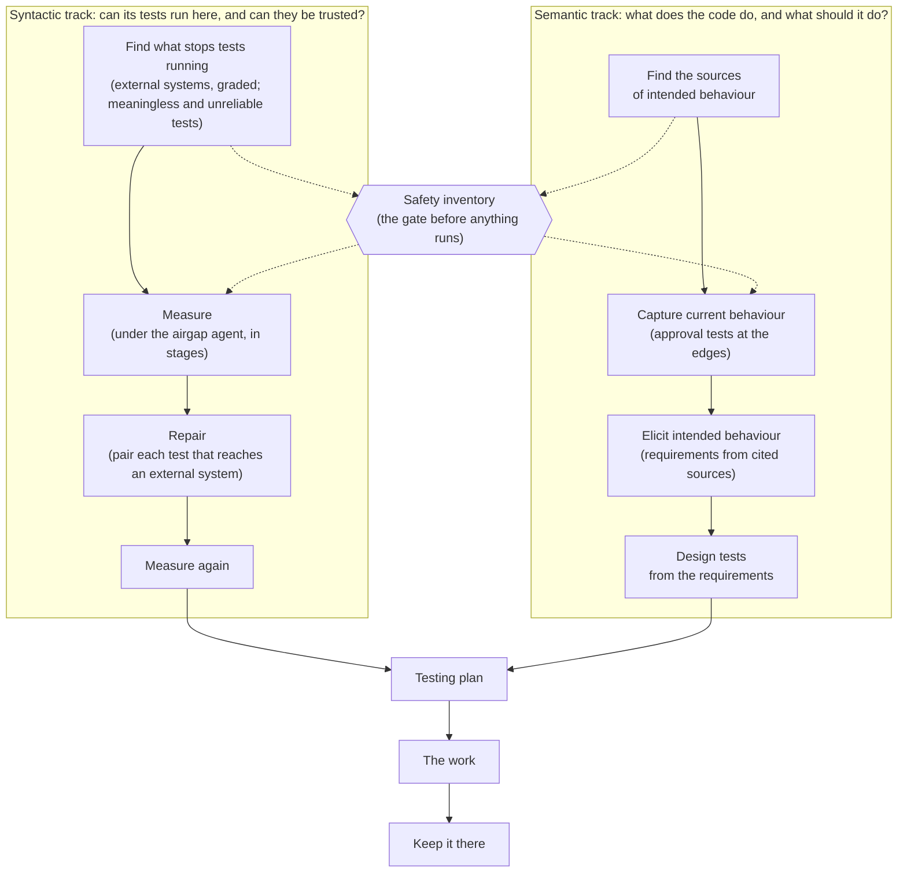
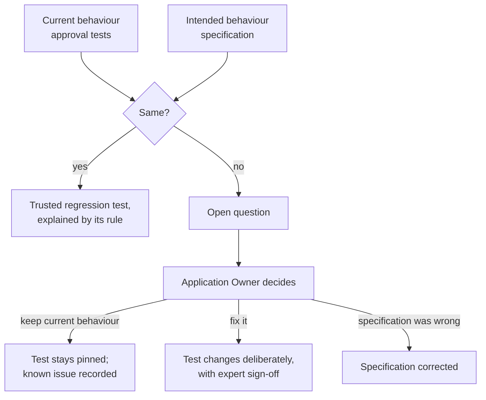
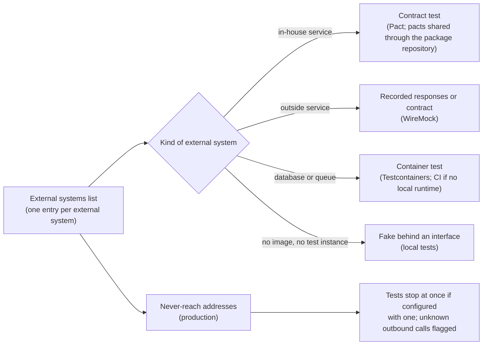
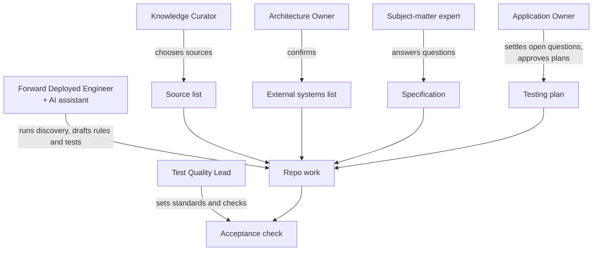

# A repo's journey: diagrams

Four diagrams showing how one repo moves from "we don't know what it does" to "tested to its target", and who does what.
They are drawn by GitHub from the text below (Mermaid), so they never go stale. Words follow [GLOSSARY.md](../../GLOSSARY.md);
the decisions behind them are in [decision-guides/](../../decision-guides/README.md).

## 1. The repo journey

Two tracks, joined at the testing plan; [the journey page](../JOURNEY.md) says who does each step and links every
decision guide, and [the drawing](repo-journey.excalidraw) names each step's skill.

## 2. Current and intended behaviour, compared

## 3. External systems list to test types

## 4. Who does what

