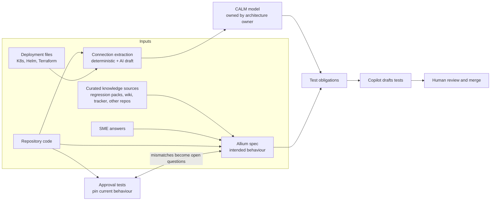
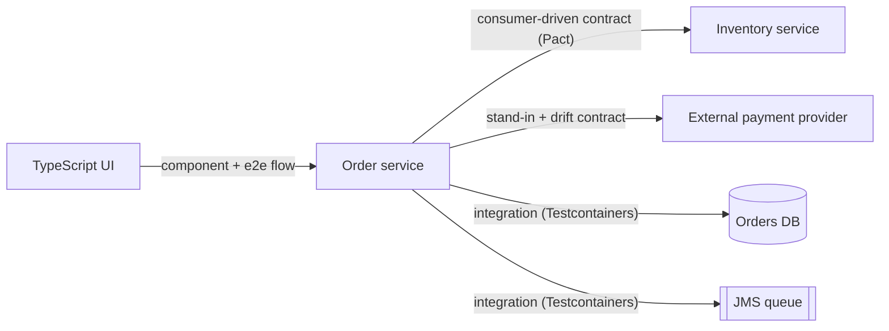
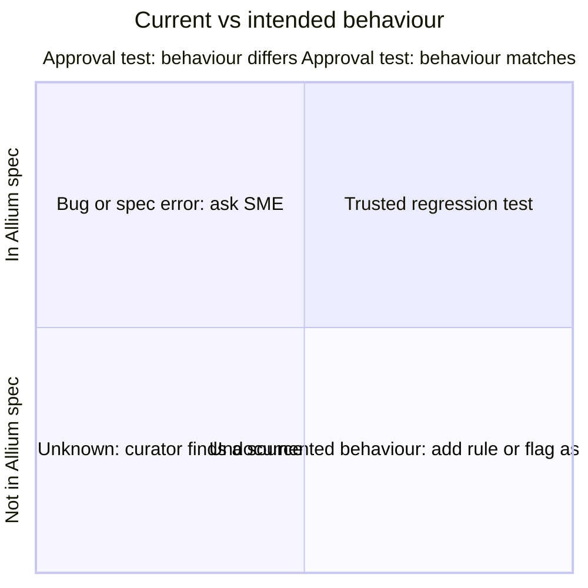

<!-- Research report: how architecture modelling (FINOS CALM) and behaviour specification (Allium and others) can inform test design. Kept as background; the decisions it led to are in decision-guides/. -->

# Map the system, then pin its behaviour

The toolkit should use two separate models to plan tests. The first is a model of the system's connections, written in FINOS CALM. It decides where tests sit and what kind each one is. The second is a model of the system's behaviour, written in JUXT's Allium and backed by approval tests and examples agreed with subject-matter experts. It decides what each test checks. The two do different jobs and should not be merged. No official tool generates CALM from code. The CALM project's own route is an AI "discovery" skill whose output its authors call a draft "typically 80–90% complete". The only tool that generates CALM from code without an AI model is Moderne's Prethink, which is source-available and partly proprietary. A small, early open-source tool can derive CALM from container and Kubernetes files, but not from Java code. Allium is the closest fit for turning recovered behaviour into tests. It is MIT-licensed, works in GitHub Copilot agent mode, and has a command-line tool that produces a repeatable list of what must be tested. But Allium is young, and its "distil a spec from code" skill deliberately records behaviour "as intended, not as implemented". That is the opposite of what legacy regression work needs first. So the toolkit should pin current behaviour with approval tests, record intended behaviour in Allium, and send every disagreement between the two to a named expert. Nothing off the shelf reads regression packs, wiki pages or tracker history into this process, so that intake step, plus the CALM-to-test-plan mapping, is what has to be built. The project also needs new roles: someone to curate knowledge sources, an owner for the architecture model, and subject-matter experts (SMEs) with real time set aside to answer questions.

## Two models answer two different testing questions

A legacy repository answers "what code is here?" well. It answers "what does this system talk to?" only partly, and "what is it supposed to do?" hardly at all. The research suggests splitting the problem the same way. A **connectivity model** says where the test boundaries are and what kind of test belongs at each one. A **behaviour model** says what each test should check and what the expected answer is. CALM is a good fit for the first, and Allium together with older techniques fits the second. Neither replaces the other. CALM is explicitly a model of nodes, relationships, interfaces, flows and controls ([calm-schema CHANGELOG](https://github.com/finos/calm-schema/blob/main/CHANGELOG.md)). Allium's README says it "has no compiler and no runtime" and deliberately leaves out database schemas and API designs ([juxt/allium](https://github.com/juxt/allium)). Allium covers business rules and state changes. CALM covers the wiring.

This split also matches what each source of knowledge can tell you. Code and deployment files reveal most of the wiring. CALM's own tutorial warns that source code "rarely captures the full architectural picture … runtime behavior, external dependencies, business intent, security controls … infrastructure defined outside the repository" ([CALM discovery tutorial](https://github.com/finos/architecture-as-code/blob/main/docs/docs/tutorials/build-a-calm-architecture/architecture-discovery-skill-tutorial.md)). Behaviour is even harder to recover from code alone. Research on pulling business rules out of legacy code shows the best pipelines matching expert-written rules about **93%** of the time ([Kalohia, ACL 2026 Industry](https://aclanthology.org/2026.acl-industry.4/)). Even that leaves a gap that only people can close. This is why the toolkit has to bring in organisational knowledge and expert answers by design. They cannot be an optional extra.

## CALM tells you where tests go, but nothing yet turns it into a test plan

### What CALM is and how ready it is

CALM (Common Architecture Language Model) is a JSON Schema format for describing architecture as data. Morgan Stanley open-sourced it through FINOS, and it is licensed under **Apache-2.0**. The latest schema is **1.3**, published to npm as `@finos/calm-schema`. Version 1.2 added "decorators", which attach extra information such as deployment state to parts of the model, and "timelines", which record snapshots of the architecture over time ([calm-schema README](https://github.com/finos/calm-schema); [CHANGELOG](https://github.com/finos/calm-schema/blob/main/CHANGELOG.md)). The tools release very often. The command-line tool reached **v1.74.0**, after about 15 minor releases in ten weeks ([GitHub releases](https://api.github.com/repos/finos/architecture-as-code/releases)). The schema itself changes only a few times a year, so the toolkit should fix both the schema version and the tool version it uses. Evidence of use outside Morgan Stanley is thin. FINOS says CALM has "over 2,000 deployments" and a spokesperson says it is "in use in several firms", but both claims come from the project itself ([Banking Dive](https://www.bankingdive.com/news/morgan-stanley-open-source-software-development-finos-calm/758406/)). Thoughtworks puts CALM in **Assess** on its Technology Radar, meaning "worth exploring, not yet a default" ([Thoughtworks Radar](https://www.thoughtworks.com/radar/languages-and-frameworks/calm)).

For a locked-down corporate, the good news is that everything comes through standard channels that an internal package repository can proxy:

- the command-line tool, validation server and schema on npm;
- CALM Hub, the model store, as Docker images;
- the Java models on Maven Central;
- the VS Code extension as a downloadable VSIX file.

The AI assistance is not a separate download. `calm init-ai -p copilot` writes Copilot prompt files straight into the repository ([calm-ai README](https://github.com/finos/architecture-as-code/blob/main/calm-ai/README.md); [CLI README](https://github.com/finos/architecture-as-code/blob/main/cli/README.md)). One practical limit: the command-line tool needs **Node 22.13 or later**.

### Can CALM be generated from code or deployment files?

The short answer is: not deterministically, using official tools. `calm generate` only fills in a skeleton from a CALM *pattern* file. It takes no source code as input ([CLI README](https://github.com/finos/architecture-as-code/blob/main/cli/README.md)). The official route from code to CALM is an AI skill called `calm-architecture-discovery`. It is written for CALM 1.3 and reads:

- build files;
- Dockerfiles;
- Kubernetes and Helm files;
- Terraform;
- Spring configuration files;
- REST controller annotations;
- database, HTTP and messaging clients;
- OpenAPI and AsyncAPI specifications.

It only produces the "connects" and "interacts" kinds of relationship, and it must show a banner saying the output "may contain inaccuracies or omissions" ([discovery skill](https://github.com/finos/architecture-as-code/blob/main/docs/static/calm-skills/architecture-discovery-skill.md)). It can be installed under `.github/skills/` for Copilot. The project has published sample runs of the skill against its own repository by Copilot, Claude, Kiro and Codex. The Kiro run, for example, found 10 nodes and 8 relationships ([sample output](https://calm.finos.org/calm-discovered-artifacts/kiro-discovered-calm-architecture.json)).

There are three options that do not rely on an AI model, and each has a catch:

- **Moderne/OpenRewrite Prethink.** It includes a `GenerateCalmArchitecture` recipe that turns discovered endpoints, database connections, outbound HTTP calls (RestTemplate, WebClient, Feign) and Kafka, RabbitMQ or JMS messaging into CALM JSON. It is on Maven Central as `rewrite-prethink` 1.2.0, but under the **Moderne Source Available License**, and the recipes that actually discover these connections sit in a package marked **Moderne Proprietary**. They were not in the published jar. The generated file also targets an older draft schema, `draft/2025-03`, not 1.3 ([rewrite-prethink POM](https://repo1.maven.org/maven2/org/openrewrite/recipe/rewrite-prethink/1.2.0/rewrite-prethink-1.2.0.pom); [jar](https://repo1.maven.org/maven2/org/openrewrite/recipe/rewrite-prethink/1.2.0/rewrite-prethink-1.2.0.jar); [Moderne docs](https://docs.moderne.io/user-documentation/agent-tools/prethink)). It is the only tool that maps tests to the code they cover next to its CALM output (a `TestMapping` table and a `FindEndpointContracts` recipe aimed at generating contract tests). That shows the idea can be done, but in practice it means licensing Moderne.
- **`@enwithai/architecture-check`.** An offline, early (pre-1.0) npm tool that builds CALM 1.3 from Docker Compose, Dockerfiles, Kubernetes, TypeScript imports, environment hostnames and OpenAPI ownership. It reports "drift" (differences from a declared model) as SARIF results, and grades each finding as a verified fact, a hypothesis or unknown ([repo](https://github.com/EnWithAI/architecture-check)).
- **blueprint-discoverer.** A prototype that reads several repositories at once, parses Java, TypeScript and other languages, and records a file-and-line reference for every element it finds. It outputs CALM 1.0 ([repo](https://github.com/osnirmaster/blueprint-discoverer)).

Both community tools have **0–2 stars**.

Several gaps matter for this portfolio in particular. No tool found reads J2EE-era files such as `web.xml`, `ejb-jar.xml` or application-server JNDI configuration into CALM. There is no converter from Structurizr, Backstage or OpenTelemetry into CALM. Converting draw.io diagrams to CALM exists only as an experimental, unpublished step ([hackathon PR #67](https://github.com/finos-hack/fall-hackathon-2026-rho/pull/67)). Other open tools each extract part of the picture, and each would need a translator to produce CALM:

- Spring Modulith and Structurizr's component finder show structure inside a single application.
- jQAssistant loads code into a queryable graph.
- ArchUnit checks structural rules.
- Konveyor flags J2EE technology use such as JMS, JNDI and EJB.
- OpenTelemetry's service graph shows connections actually seen at runtime.
- dependency-cruiser maps how TypeScript modules depend on each other.

([architecture extraction notes: Spring Modulith docs](https://docs.spring.io/spring-modulith/reference/documentation.html); [Structurizr component docs](https://docs.structurizr.com/java/component); [OTel servicegraph](https://pkg.go.dev/github.com/open-telemetry/opentelemetry-collector-contrib/connector/servicegraphconnector)).

### Turning connections into test design

CALM's own testing story is about conformance, not functional testing. `calm validate` can output JUnit results and fail a build. `calm diff --exit-code` flags architecture changes. A 2026 **control-evaluation decorator standard** records a pass or fail result for each control against each commit, so that "the architecture then holds its own compliance history" ([CLI README](https://github.com/finos/architecture-as-code/blob/main/cli/README.md); [control-evaluation standard](https://github.com/finos/calm-schema/blob/main/standards/control-evaluation/README.md)). We found **no official material linking CALM flows or interfaces to contract tests or to generated functional tests**. That link is open ground.

The established test-design approach already maps neatly onto a connection graph. Martin Fowler's contract tests check that a stand-in for an outside service still behaves like the real thing ([Fowler, ContractTest](https://martinfowler.com/bliki/ContractTest.html)). Thoughtworks calls consumer-driven contracts "an essential part of a mature microservice testing portfolio" ([Thoughtworks Radar](https://thoughtworks.com/radar/techniques/consumer-driven-contract-testing)). Toby Clemson's testing-strategy article lays out a ladder from unit tests up to end-to-end tests ([martinfowler.com](https://martinfowler.com/articles/microservice-testing/)). The toolkit can apply these as simple rules over each CALM element. The table below states those rules. It is the core of what should be built.

| CALM element | Test it implies | Typical tool (all mirrorable) |
|---|---|---|
| Connection between two in-house services (HTTP or messaging) | Consumer-driven contract test | Pact (MIT) or Spring Cloud Contract |
| Connection to an outside third-party system | Stand-in (mock) for the outside service, plus a drift-check contract test | WireMock, Pact |
| Connection to a database or queue node | Integration test against real infrastructure | Testcontainers |
| A node's own interfaces | Component test, with every outbound connection replaced by a stand-in | JUnit 5, Spring Boot test slices |
| A CALM flow (ordered steps with descriptions) | A candidate for the small end-to-end suite | Playwright (UI), REST-assured |
| CALM controls and patterns | "Fitness functions": automated checks that the architecture still follows its rules | `calm validate`, ArchUnit |
| Mismatch between connections found in code and connections seen at runtime | Missing or dead integration that needs a test, or removal | OpenTelemetry service graph, compared against CALM |

Two refinements make this mapping more trustworthy. First, architecture-check's rule should be adopted: a declared connection with no code evidence is "unknown", **never "absent"** ([architecture-check](https://github.com/EnWithAI/architecture-check)). This matters because legacy systems often hide connections in configuration-driven URLs and JNDI lookups. Second, test results can flow back into the model. A test run can write a pass or fail result per control per commit using the control-evaluation decorator, which makes test evidence part of the architecture record.

## Behaviour must be pinned first and argued about second

### Allium is the strongest fit, with one important twist

Allium is MIT-licensed and comes from JUXT. It describes behaviour as entities with states, and as rules written in a when / requires / ensures form ("when this happens, if this is true, then this must result"). It also supports invariants (facts that must always hold), configurable defaults, behaviour deliberately left to the implementation, and explicit **`open question`** declarations ([language reference](https://juxt.github.io/allium/language); [README](https://github.com/juxt/allium)). It ships agent skills:

- `/elicit` builds a spec through conversation;
- `/distill` recovers a spec from existing code;
- `/propagate` generates tests from the spec;
- `/tend` makes targeted spec edits;
- `/weed` finds and fixes divergence between spec and code.

Copilot in agent mode reads these skills from the repository "without installation". Autocomplete-only assistants are not supported ([README](https://github.com/juxt/allium)). The separate Rust command-line tool (MIT, **v3.7.2**) includes `allium plan`. This command lists every "test obligation" as JSON and gives the same output every time for the same spec: success and failure cases for each rule, and validity checks for each state transition. `allium diff` compares these lists between versions ([allium-tools](https://github.com/juxt/allium-tools); [Allium v3](https://juxt.github.io/allium/v3)). This is the feature that sets Allium apart from Spec Kit, Kiro, Tessl and BMAD. All of those keep Markdown specs that Copilot can read, but **none produces test obligations deterministically** ([Spec Kit](https://github.com/github/spec-kit); [Kiro specs](https://kiro.dev/docs/specs/); [Tessl](https://tessl.io/blog/tessl-launches-spec-driven-framework-and-registry/); [BMAD](https://github.com/bmad-code-org/BMAD-METHOD)). A repeatable obligation list gives reviewers and auditors something stable to check AI-drafted tests against.

The twist is in the `/distill` skill. It tells the agent to describe buggy behaviour "as intended, not as implemented", to leave out legacy, dead or experimental code, and to check its findings with developers and stakeholders. Its named sources are code, people and git history. It does **not** mention tests, documentation or tickets ([distill SKILL.md](https://github.com/juxt/allium/blob/main/skills/distill/SKILL.md)). For new work, "as intended" is exactly right. For a legacy system that is about to be moved to Spring Boot 4, it is risky. The first job of a regression suite is to detect any change, including changes to behaviour that downstream users have come to rely on, bugs included. Characterisation (approval) tests do exactly that, and they make no claim that the behaviour is correct ([Wikipedia: Characterization test](https://en.wikipedia.org/wiki/Characterization_test); [DZone](https://dzone.com/articles/testing-legacy-code-golden)).

### The answer is two tracks that are compared, not one spec

The toolkit should run two tracks side by side and treat every mismatch between them as a question for a person:

- **Track one pins current behaviour.** It captures what the system does today with ApprovalTests (Java v32.0.0; npm `approvals` v7.3.0, Apache-2.0). These are cheap to write and very actively maintained ([spec landscape table: Maven Central / npm](https://repo1.maven.org/maven2/)).
- **Track two records intended behaviour** as an Allium spec, built from code, organisational knowledge and expert answers.

Where the two agree, the approved output becomes a trusted regression test, and the Allium rule becomes its readable explanation. Where they disagree, the result is one of three things: a bug that has been accepted (keep the test pinned to current behaviour, and record a known issue), a bug that will be fixed (change the test deliberately, with expert sign-off), or a misunderstanding in the spec (correct the spec). The `superkit` reverse-engineering skill already uses this habit of recording bugs in a known-issues file instead of quietly fixing them ([skills.sh](https://skills.sh/pixel-process-ug/superkit-agents/reverse-engineering-specs)). Allium's `/propagate` expects newly generated tests to **fail first**, and treats a test that passes straight away as either already covered or meaningless ([README](https://github.com/juxt/allium)). On legacy code that rule needs adjusting. A test that passes against current behaviour is the desired outcome on track one.

### Older techniques each have a narrower, specific role

Specification by example is still the best way to get an expert to agree to concrete cases. Cucumber is still releasing (cucumber-java 8.1.0, @cucumber/cucumber 13.3.0). It is now run by its community through the Open Source Collective, after SmartBear stepped back ([SmartBear](https://smartbear.com/blog/cucumbers-next-chapter-a-community-driven-future)). One known weakness is that a 2025 thesis found stakeholders struggle to negotiate requirements written in Gherkin ([Alshammari 2025](https://theses.gla.ac.uk/85190/2/2025AlshammariPhD.pdf)). So the conversation, held in a structured format such as Example Mapping, is worth more than the Gherkin file it produces. FitNesse decision tables suit legacy systems heavy in calculations. Concordion (Apache-2.0) is stable but quiet, with its last release in 2023.

Contracts, using OpenAPI, AsyncAPI and Pact, fix behaviour at the boundaries that CALM identifies. Pact's own docs warn that checking a provider against an OpenAPI document alone gives no assurance that consumers call it correctly ([Pact docs](https://docs.pact.io/)).

Property-based testing generates many test inputs automatically and checks that a stated property always holds. Allium invariants translate directly into it. On the JVM, though, the obvious library, **jqwik, has been in pure maintenance mode and has shipped an "Anti-AI Usage Clause" since version 1.10** ([jqwik README](https://github.com/jqwik-team/jqwik)). For a toolkit built around AI-drafted tests, that is a blocker until legal has reviewed it. fast-check (MIT) is unaffected on the TypeScript side.

Formal methods such as TLA+, Quint, Alloy and P are proven for concurrency and protocol designs. AWS found two bugs in an S3 fault-tolerance algorithm using TLA+ ([Newcombe et al.](https://6826.csail.mit.edu/2019/papers/formal-methods-amazon.pdf)). They are a poor fit for ordinary business rules and need specialist skill. They should be a rare add-on, not a default.

### Organisational knowledge needs an intake step that nobody sells

No skill found takes in Jira, Confluence or existing regression packs as a source of specs. The strongest open skills for recovering specs from code are Allium `/distill`, `spec-miner` (EARS-format output with code evidence) and `doc-this` (traceable output ready for acceptance tests). All of them work from code ([spec-miner](https://tessl.io/registry/skills/github/Jeffallan/claude-skills/spec-miner); [doc-this](https://tessl.io/registry/wagneripjr/doc-this/files/skills/doc-this/SKILL.md)). Atlassian's Rovo MCP server gives AI clients access to Jira and Confluence within each user's own permissions. The test-generation workflows built on it come from vendors such as Katalon, AIO Tests and mabl, which need Atlassian Cloud and their own products ([Rovo MCP GA](https://www.atlassian.com/blog/rovo/atlassian-rovo-mcp-ga?nb=1); [Katalon](https://docs.katalon.com/katalon-studio/studioassist/mcp-servers/atlassian-mcp-server-best-practices)). A corporate running Jira Data Center behind a firewall, or one whose approved assistant cannot reach a remote server, will not be able to use Rovo directly.

The research on what works points the same way every time. Extract with traceability back to each source (a line of code, a Confluence page version, a Jira key). Check against a sample of rules written by experts. Keep a person in the loop. Kalohia's 93% agreement came from deterministic parsing combined with schema-constrained AI generation and links in both directions between rules and code ([ACL 2026](https://aclanthology.org/2026.acl-industry.4/)). A vendor reports an 85.5% expert-validation rate, which has not been peer reviewed ([dev.to](https://dev.to/mozzello/how-to-extract-business-rules-from-legacy-cobol-code-2fhn)). A miss rate of 7–15% is small enough to be useful, and large enough that expert sign-off can never be skipped.

### Expert time should be spent on questions, not on reading

The expert's job should be answering sharp questions, not reviewing long drafts. Example Mapping uses coloured cards: rules on blue, examples on green, and unanswerable questions on **red**. A session takes about 25 minutes per story, and needs at least the "three amigos": a developer, a tester and a product person ([Cucumber blog](https://cucumber.io/blog/bdd/example-mapping-introduction/)). EventStorming marks disagreements as "hotspots" for follow-up ([DDD-crew glossary](https://www.github.com/ddd-crew/eventstorming-glossary-cheat-sheet)). Matt Pocock's `grill-me` skill has the AI question the human until every open decision is settled ([skills.sh](https://www.skills.sh/mattpocock/skills/grill-me)). Allium's `open question` construct is the natural place to store red cards, so that unanswered questions stay inside the spec until someone answers them. The workflow becomes:

1. The AI drafts candidate rules, each with a source reference.
2. It runs them against the approval-test output.
3. It produces a short list of red-card questions.
4. The expert answers them in a timed session.
5. The answers become Allium rules.
6. `allium plan` lists the tests to write.
7. Copilot drafts those tests.
8. A developer reviews them.

## What to adopt, what to build, and how to get it inside the firewall

### Adopt: third-party pieces and how to mirror them

Everything below can reach a corporate that installs only through its own Artifactory or Nexus repository. Agent skills and prompt files are plain Markdown. Someone with approved external access imports them once, a security reviewer reads them (the registry scan flagged that `spec-miner` may copy secret values into its output ([tessl](https://tessl.io/registry/skills/github/Jeffallan/claude-skills/spec-miner))), and they are stored in an internal repository or wrapped as a versioned npm or Maven package, so they travel through the same channel as everything else.

| Component | Licence | How a corporate mirrors it | Adoption stance |
|---|---|---|---|
| FINOS CALM schema 1.3, CLI 1.74.x, calm-server ([npm](https://registry.npmjs.org/@finos/calm-cli)) | Apache-2.0 | npm proxy. Fix the versions. Change the `$ref` allowlist to point at an internal copy of the schema | Adopt |
| CALM VS Code extension | Apache-2.0 | VSIX from releases, held in the internal artefact store | Adopt |
| CALM Hub (Docker) | Apache-2.0 | Docker registry mirror. Its AI connection point (MCP) is experimental and off by default | Optional, later |
| CALM discovery skill and `calm init-ai -p copilot` prompts | Apache-2.0 | Bundled with the CLI, or vendored under `.github/skills/` | Adopt as the first draft source |
| Allium skills and agents (`juxt/allium`) | MIT | Vendor the plain files into the repository. Copilot reads `.github/agents/` | Adopt, fixing a language version |
| Allium CLI (`allium-cli` on crates.io) | MIT | Cargo proxy, or build internally and sign the binary (the macOS and Windows release binaries are unsigned) | Adopt. The skills work without it, but the repeatable test list does not |
| ApprovalTests (Java and JS) | Apache-2.0 | Maven / npm proxy | Adopt as the backbone of track one |
| Pact JVM / JS, Testcontainers, WireMock | MIT / Apache | Maven / npm proxy | Adopt for the boundaries CALM identifies |
| ArchUnit, Spring Modulith docs | Apache-2.0 (not confirmed from source) | Maven proxy | Adopt for fitness functions and module maps |
| Cucumber JVM / JS | MIT | Maven / npm proxy | Optional, where experts want readable scenarios |
| fast-check | MIT | npm proxy | Adopt for TypeScript invariants |
| jqwik | EPL-2.0 **plus an anti-AI clause** | Maven proxy | **Do not adopt** until legal has reviewed it |
| GitHub Spec Kit | MIT | Offline wheel build following the [air-gapped guide](https://github.github.com/spec-kit/install/air-gapped.html) | Optional, for forward-looking change work |
| Moderne Prethink | Source-available, with proprietary discovery recipes | Maven Central, but needs a Moderne licence to be useful | Only if the organisation already licenses Moderne |
| `@enwithai/architecture-check` | Check the repository licence before use | npm proxy | Trial for containers and TypeScript. Too young to depend on |

### Build: thin glue, kept to the minimum

The research points to six pieces that have to be built, and none of them is a new standard.

**First, a deterministic Java/J2EE connection extractor that outputs CALM 1.3.** It should be written as OpenRewrite search recipes, or on top of the open `rewrite-spring` search recipes `FindApiEndpoints` and `FindApiCalls` (licence and coverage still to be confirmed). It needs to cover:

- Servlet, JAX-RS and Spring endpoints;
- RestTemplate, WebClient, Feign and RestClient clients;
- JDBC and JPA data sources;
- JMS, Kafka and Rabbit listeners;
- the `web.xml`, `ejb-jar.xml` and JNDI files that no current tool reads.

Its output should be checked with `calm validate` and merged with the AI discovery draft, with each element labelled as coming from evidence or from the model.

**Second, a CALM-to-test-plan mapper** that applies the rules in the table above and produces a list of test obligations in the same shape as `allium plan`. Then one dashboard can show both connection tests and behaviour tests.

**Third, a knowledge-source intake skill and manifest.** It is a curated list of regression packs, wiki exports, tracker queries and related repositories. Each entry carries a date, an owner and a trust level. Candidate rules extracted from these sources must cite where they came from.

**Fourth, a comparison step** that lines up approval-test output against Allium rules and writes each mismatch as an Allium `open question`.

**Fifth, a writer that turns test results into control-evaluation decorators**, so test evidence is stored in the CALM model.

**Sixth, the packaging that makes all of this installable offline.** That means a versioned bundle of vendored skills, fixed CLI versions and internal schema copies.

### Diagrams that would explain the approach

Six diagrams would carry most of the explanation:

1. **Toolkit context diagram.** It shows the inputs (repository, deployment files, curated knowledge sources, expert answers) feeding two models (CALM and Allium plus approvals). These feed one list of test obligations, which leads to AI-drafted tests and a human review gate.
2. **CALM test-boundary map.** It colours a sample architecture by test type: contract, stand-in, integration, component and end-to-end. This is the table above drawn as a picture, and it is the clearest way to explain why the connectivity model matters.
3. **Pinned-versus-intended grid.** It sets current behaviour (from approvals) against intended behaviour (from Allium). Where they agree, the result is a regression test. Where they disagree, the result is an accepted bug, a planned fix or a spec correction, and each disagreement goes to a named expert.
4. **Knowledge pipeline.** It runs from sources through candidate rules with citations, red-card questions, the expert session, the Allium spec, `allium plan`, Copilot drafts and review.
5. **Supply-chain diagram.** It shows how each component reaches the developer's machine through npm, Maven, Cargo and Docker proxies, the VSIX store, and the internal repository of vendored skills.
6. **Responsibility swimlane.** It shows who curates, who answers, who reviews and who signs off at each stage.

The first three, as Mermaid sketches:

## Five roles, not one tester, carry the engagement

The tooling does not remove the human work. It concentrates that work in a few roles that most engagements currently leave unnamed. No published framework defines a "knowledge curator". SAFe names Business Owners, Example Mapping names the three amigos, and EventStorming separates the people who bring questions from the people who bring answers ([SAFe Business Owners](https://framework.scaledagile.com/business-owners); [Cucumber blog](https://cucumber.io/blog/bdd/example-mapping-introduction/); [DDD-crew](https://www.github.com/ddd-crew/eventstorming-glossary-cheat-sheet)). The roles below are therefore a recommendation drawn from those sources, not an industry standard.

| Role | What they own | Usually filled by |
|---|---|---|
| **Knowledge curator** | The source manifest: which regression packs, wiki spaces, tracker queries and related repositories count, how old each is, and which are out of date | A business analyst or domain lead |
| **Subject-matter expert (answerer)** | Answering red-card questions and signing off intended behaviour, rule by rule | A business user or long-serving developer |
| **Architecture owner** | The CALM model for the system: accepting or rejecting discovered connections and owning boundary contracts | Solution or enterprise architect |
| **Arbiter** | Deciding when the current and intended behaviour disagree, such as "fix it" versus "keep the bug", and setting priorities | Product owner or business owner |
| **Test engineer / reviewing developer** | Reviewing AI-drafted tests against the obligation list, and owning the approval files | Quality engineer or developer |
| **Toolkit steward** | Mirrored versions, security review of vendored skills, licence checks, keeping schema and CLI versions fixed | Platform or developer-experience team |

This changes how an engagement is structured in four ways:

- **Each repository needs a discovery phase**, before any coverage targets, that produces a draft CALM model, an initial approval-test baseline and a curated source manifest.
- **Expert time must be booked in advance as a budget**, such as a fixed number of 25-minute question sessions per bounded area. It should not be requested ad hoc. Unanswered questions block sign-off but not test writing.
- **Progress should be tracked by obligations met**, from `allium plan` plus the CALM mapper, alongside line coverage. Line coverage alone rewards AI-generated tests that check nothing.
- **A visiting team that sets up the tooling** and runs the first sessions (the "forward deployed engineer" model that Palantir made popular) suits rolling this out across many repositories, but each repository's model and spec must end up owned by the client team ([Pragmatic Engineer](https://newsletter.pragmaticengineer.com/p/forward-deployed-engineers)).

## Recommendations

| # | Recommendation | Why |
|---|---|---|
| 1 | Make **approval tests the first deliverable** on every legacy repository, before any Spring Boot 4 migration step | They are cheap, mature and Apache-licensed, and they detect any change, which is the main risk during a migration |
| 2 | Adopt **CALM 1.3 as the connectivity model**, fix the schema and CLI versions, and validate in CI with JUnit output | Open standard, mirrorable, and it gives every connection a stable ID for test planning |
| 3 | Draft CALM with the **official discovery skill in Copilot**, cross-checked by a **deterministic extractor built in-house** for Java/J2EE. Treat connections without evidence as "unknown" | The AI draft is roughly 80–90% complete and comes with no guarantees. No open deterministic Java extractor exists |
| 4 | Build the **CALM-to-test-plan mapper**, using contracts at in-house boundaries, stand-ins at external ones, Testcontainers at data stores, and flows as end-to-end candidates | This is the missing link, and the rules are well established |
| 5 | Adopt **Allium for intended behaviour**, fixing the language version and vendoring the skills. Use `allium plan` output as the reviewable list of what must be tested | It is the only tool that produces test obligations repeatably, and it works in Copilot agent mode |
| 6 | **Change `/distill`'s instruction** for legacy work so that current and intended behaviour are both recorded, and every difference becomes an `open question` | This reconciles Allium's "as intended" stance with the need to pin current behaviour |
| 7 | Build a **knowledge-source intake skill and manifest**, with citations required on every extracted rule | No existing skill reads regression packs, wiki pages or tracker history |
| 8 | Run **Example Mapping-style expert sessions** driven by AI-prepared red-card questions | It uses expert time efficiently and leaves a record of decisions |
| 9 | Name the **curator, architecture owner, expert, arbiter and toolkit steward** in every engagement, and book expert time as a budget | The tooling cannot replace these decisions |
| 10 | Use fast-check for TypeScript property tests. **Hold jqwik** until legal review, and look at other JVM property-testing options | jqwik's anti-AI clause and maintenance mode |
| 11 | Use Moderne Prethink **only if already licensed**. Do not build on its proprietary discovery recipes otherwise | Source-available and proprietary licensing, and an older target schema |
| 12 | Keep unattended agents out of scope. Allium's autonomous `tend` and `weed` agents should run only as human-triggered helpers for now | Matches the "AI drafts, people review" policy |

## Risks to watch

| Risk | Detail | Mitigation |
|---|---|---|
| Licences | Moderne Prethink is source-available and its finder recipes are proprietary. jqwik 1.10+ has an anti-AI clause. FitNesse's licence shows as "NOASSERTION". Several Apache licences (ArchUnit, Modulith, ApprovalTests Java) were not confirmed from the source | Licence review by the toolkit steward before anything is mirrored. Keep a licence register in the bundle |
| Tool maturity and churn | The CALM CLI releases several times a week. Allium went through three major language versions in 2026 and its tools are marked "pre-release, expect breaking changes". The community CALM extractors have 0–2 stars | Fix versions, upgrade deliberately, and keep the toolkit's own glue thin and replaceable |
| Behaviour stance | Allium `/distill` describes behaviour "as intended". Using it alone would quietly "fix" behaviour that users rely on, inside the spec and the tests | Two-track approach (Recommendation 6) |
| AI accuracy | The discovery skill gives no guarantees. Business-rule extraction reaches about 93% at best. JUXT's own case study missed wiring at component boundaries, and the author "wasn't reviewing the code in any meaningful sense" ([JUXT blog](https://juxt.pro/blog/from-specification-to-stress-test)) | Citations required on every element, expert sign-off, and review by a developer of every AI-drafted test |
| Stale knowledge | Wiki and tracker content describes intended or past behaviour | The curator dates and grades sources. Approval output settles disputes about what the system actually does |
| Connectivity limits | Copilot cannot reach public GitHub, and Rovo MCP needs Atlassian Cloud | Vendor all skills. Use exports or an internal connector for Data Center |
| Security of third-party skills | `spec-miner` was flagged for possibly copying secret values into its output | Every vendored skill is read in full and reviewed before it is mirrored |
| Thin CALM adoption evidence | Adoption outside Morgan Stanley is self-reported. Thoughtworks rates it "Assess" | Use only the open schema and CLI, so that leaving later is cheap |

Several things remain unknown and should be checked before committing:

- the exact CALM version Prethink emits today;
- the licence and coverage of the open `rewrite-spring` search recipes;
- whether the community extractors' licences permit corporate use;
- which JVM property-testing library could replace jqwik;
- whether any peer-reviewed study supports converting manual regression packs into executable specs. None was found.

## Conclusion

The main insight is that "raise test coverage across legacy repositories" is really three separate problems: finding the boundaries, pinning what happens today, and agreeing what should happen. Off-the-shelf tools cover the first two well and the third only partly. The gaps are narrow and specific: a Java/J2EE connection extractor, a CALM-to-test-plan mapper, a knowledge intake step and a step that compares current with intended behaviour. That means the toolkit can be mostly assembly rather than invention, which fits the rule that building our own is a last resort. The deeper change is organisational. Once AI drafts both the architecture model and the behaviour spec, the scarce resource is no longer people who can write tests. It is people who can say with authority what the system connects to and what it should do. Engagements that name and budget for the curator, the architecture owner and the expert will turn AI output into trusted tests. Engagements that do not will mostly produce higher coverage numbers that check little.
